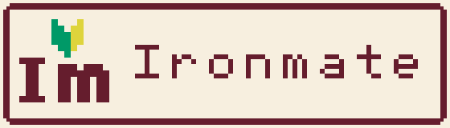
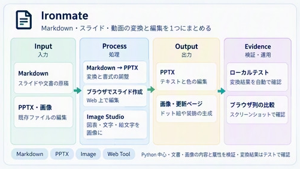
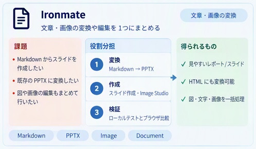

# Ironmate



Ironmate is a Python project for transforming and checking the **content and attributes of documents and images**. It contains several independent prototypes and helpers:

- **Markdown → PPTX** conversion through `pptx_pipeline.py`, plus attribute editing of existing PPTX files (text, colors, arrows).
- **Image Studio** and **Slide Studio**: browser-based editors that run locally or as static GitHub Pages.
- **Pixel-grid art**: deterministic color-ID grids from procedural shapes, and a first step from Base64 or image files (photo → grid).
- **Verification helpers**: byte-level PNG/SVG checks, round-trip tests, and screenshot comparison sheets.

Status: these are prototypes, not one integrated UI. Requirements are tracked in [Issue #80](https://github.com/myon-bioinformatics/Ironmate/issues/80). The dot-art prototype was merged in [PR #79](https://github.com/myon-bioinformatics/Ironmate/pull/79). Markdown → PPTX and PPTX attribute editing are prototypes. Photo conversion is limited to the first stage (Base64 → color-ID grid). Character-part composition is not implemented.

**Logo.** The logo is the apostrophe of “I’m” replaced with 🔰. Six candidates are kept for different uses. For now, a dark green favicon, a Famicom-style README mark, a heat-map color scheme for the web UI, and a Pixel 3D home-screen icon are provisional. The final version is undecided. Browse the [six-candidate gallery](https://myon-bioinformatics.github.io/Ironmate/brand/) and see [design and regeneration notes](docs/brand.md).

## Concept diagrams

<a href="docs/assets/repository-concept.png"></a>

These diagrams were supplied as-is and cropped from the original sheet. Each feature is an independent prototype or helper. The diagrams do not show every format converting into every other format, or one unified UI that exposes everything. See [crop metadata](docs/assets/repository-concept.json) and the sections below for what is implemented and what is not.

### Challenges, roles and outcomes

<a href="docs/assets/repository-concept-v2.png"></a>

This second diagram supplements the processing flow above. Existing diagrams and feature limits are unchanged. “Can also convert to HTML” refers to specific paths, such as the Marp HTML preview generated from Markdown source. It does not guarantee that an edited PPTX is reproduced faithfully in HTML. See [preview versus PPTX verification](docs/pptx-cli-prototype.md) and [crop metadata for the second diagram](docs/assets/repository-concept-v2.json).

## Image Studio: place shapes, text and emoji, then export an image

Run `python -S image_studio.py` to open a local editor. Overlay shapes, images and custom stamps. Change the heat-map color steps or mosaic size, then export PNG, SVG, Base64 or re-editable JSON. Clocks, arrows, emoticons, monochrome stamps and CLI drawing are supported.

- [Open Image Studio in the browser](https://myon-bioinformatics.github.io/Ironmate/)
- [Open the dot-art and image gallery](https://myon-bioinformatics.github.io/Ironmate/tools/)
- [Docker startup and Pages scope](docs/browser-tools.md)
- [Usage and verification scope](docs/image-studio.md) and [real-browser screenshots and evidence](docs/evidence/image-studio/report.md)

## Slide Studio: create slides in the browser

Open [Slide Studio](https://myon-bioinformatics.github.io/Ironmate/slides/). Place titles, body text and arrows with the same controls as Image Studio, then save several slides as PPTX. Text and plain shapes are exported in a format PowerPoint can edit. See [usage and scope](docs/slide-studio.md).

## PPTX conversion and editing

Markdown is converted to PPTX through a single entry point, **`pptx_pipeline.py`**. The old `marp_pptx.py` has been removed, and no compatibility CLI is provided. Argument construction uses the pinned `vendor/cli_args.py`.

```sh
python pptx_pipeline.py slides.md -o slides.pptx
python pptx_pipeline.py --text '# Title' -o slides.pptx
printf '# Title\n' | python pptx_pipeline.py - -o slides.pptx
# Only when pre-rendering Mermaid diagrams to SVG:
python pptx_pipeline.py diagrams.md --mmdc node_modules/.bin/mmdc -o diagrams.pptx
```

- Marp CLI must be installed beforehand. The commands never install Node or npm for you.
- By default, the standard conversion does not allow local file references. With `--mmdc`, local references are allowed for trusted input only.
- The output JSON includes the conversion and PPTX inspection results.
- To change text, colors or attributes in an existing PPTX, use the separate `pptx_replace.py`. See the [prototype contract and verification status](docs/pptx-cli-prototype.md).

## Dot-art prototype: pixel grids

`pixel_grid.py` produces a reproducible color-ID grid from 5 shapes (procedurally generated), 10 palettes (color IDs `C01`–`C10`) and 4 effects. Any size within each shape's range is accepted, including odd sizes. Sizes that cannot be drawn cleanly raise an error instead of producing output.

| Shape | Size range |
| --- | --- |
| triangle | 5–256 |
| diamond | 9–256 |
| cloud | 16–256 |
| circle | 6–256 |
| rock | 7–256 |

```bash
python -S pixel_grid.py --mask cloud --palette C01 --effect shadow --size 23
python -S pixel_grid.py --mask circle --palette C02 --size 31 --format png --scale 8 > circle.png
```

See the [first-release contract, verification and design notes](docs/pixel-grid-prototype.md).


The sample above shows the five shapes across color IDs `C01`–`C10` (shadow effect), four effects on cloud and rock, and odd sizes 5, 9, 7, 13, 17 and 31. Regenerate it with `python -S grid_preview.py -o docs/pixel-grid-preview.png --force`. The test `tests/test_grid_preview.py` checks that the committed PNG is byte-identical to the regenerated image, so the implementation and the image stay in sync.

### Photo input (`photo_grid.py`)

`photo_grid.py` reads a Base64 string (raw, or `data:image/...;base64,`) or an image file and writes the same `ironmate-pixel-grid/1` format: a fixed RGBA palette plus a color-ID grid. Formats are detected from magic bytes, not from the file extension.

| Input | Support | Dependency | Notes |
| --- | --- | --- | --- |
| `.png` (8-bit gray, gray+alpha, RGB, RGBA; non-interlaced) | Supported | None (stdlib) | Decoded with `zlib`, `struct` and filter reconstruction. `tRNS` transparency is applied to alpha (RGB values are kept; pixel-identical to Pillow). The zlib stream must be complete, with its checksum; truncation or trailing data is an error. For APNG, only the default image (IDAT) is read. |
| `.png` (palette, 16-bit, interlaced) | Conditional | Pillow | The stdlib decoder reports these explicitly as unsupported. With Pillow installed, they are read through Pillow, including palette `tRNS` transparency. |
| Base64 PNG (raw string) | Supported | None | Decoded with the standard alphabet and `=` padding. URL-safe alphabets and missing padding are errors. Whitespace, CRLF line breaks and BOM are ignored. |
| data URI (`data:image/png;base64,`) | Supported | None | Same as above. A mismatch between the declared type and the content, or an unsupported type (GIF, SVG+XML, etc.), is an error. |
| `.jpg` / `.jpeg` (file, Base64, `image/jpeg`) | Conditional | Pillow | Requires a DCT/Huffman decoder, which the stdlib does not have. Without Pillow: “needs the optional Pillow package”. EXIF orientation is applied. |
| `.webp` (same as above, `image/webp`) | Conditional | Pillow | Requires a VP8/VP8L decoder. Animated files use the first frame only. |
| `.svg` | Not supported in `photo_grid.py`; limited in `grid_tools.py load` | None (numpy speeds it up if present) | `photo_grid.py` rejects SVG. `grid_tools.py load` renders a safe subset only: `rect` (fill only), `circle`/`ellipse`/`polygon` (4×4 supersampling), `g` (translate only), `#rgb`/`#rrggbb`, and `fill-opacity`/`opacity`. Anything else raises `SvgError` with a reason. SVG round-trips are not guaranteed. |
| `.gif` | Not supported | — | Rejected: LZW decoding and frame selection are not defined here. |
| `.bmp` | Not supported | — | Not adopted; rejected regardless of Pillow. |
| `.tif` / `.tiff` | Not supported | — | Compression, multi-page and color-space variety; not adopted. |
| `.ico` | Not supported | — | Multiple sizes make the selection rule undefined. |
| `.heic` / `.avif` | Not supported | — | Requires HEVC/AV1 decoding. Rejected even when some Pillow builds can read them. |
| Unrecognized bytes | Not supported | — | “unrecognized image format”. |

| Output (`--format`) | Support | Dependency | Notes |
| --- | --- | --- | --- |
| JSON (default) | Supported | None | `ironmate-pixel-grid/1` (fixed RGBA palette plus color IDs). This is the canonical data. |
| SVG | Supported | None | Written as text by `grid_svg.py`; horizontal runs of the same color become one `<rect>`. |
| PNG | Supported | None | 8-bit RGBA written with `zlib` and `struct` by `grid_png.py`. Integer scales use nearest-neighbor. The same input always produces the same bytes. |
| Base64 | Supported | None | The same bytes as PNG, encoded with `base64`. `--data-uri` adds the `data:image/png;base64,` prefix. Can be fed back to `photo_grid.py`. |
| WebP | Not supported | — | No stdlib VP8/VP8L encoder; out of scope. |
| Native PPTX shapes | Not supported | — | Out of scope by decision; image output only. |

All errors are `ValueError` (including `ImageDecodeError`). The CLI prints the reason and exits with status 2. `-o` refuses to overwrite an existing file or symlink (exit 2, “refusing to overwrite”). Use `--force` to replace it. That writes a temporary file and calls `os.replace`, so the symlink itself is replaced, not its target. This behavior is shared by all CLIs (`grid_output.py`). Pillow is not a required dependency.

```bash
base64 -w0 photo.png > photo.b64
python -S photo_grid.py photo.b64 --size 32 --colors 8
python photo_grid.py photo.b64 --size 16 --palette C01 --fit contain
python -S photo_grid.py photo.b64 --size 32 --format svg --scale 8 -o photo.svg
python -S pixel_grid.py --mask cloud --format svg > cloud.svg
python -S grid_svg.py grid.json -o grid.svg   # SVG from an existing grid JSON
python -S photo_grid.py photo.png --size 32 --format png --scale 4 -o dots.png
python -S pixel_grid.py --mask cloud --format png --scale 8 > cloud.png
python -S grid_png.py grid.json --scale 8 -o grid.png
python -S pixel_grid.py --mask cloud --format base64 --data-uri -o cloud.b64
python -S photo_grid.py cloud.b64 --size 16 --palette C01   # back to the original grid
```

See the [photo-input contract and limits](docs/pixel-grid-prototype.md#写真入力の最初の到達点base64からドットグリッドへ).

### Round trips in one line (`grid_tools.py`)

For AI agents that embed small Base64 images in a message, `grid_tools.py` combines generation, reading back, scaling and color-ID replacement into one function or one command. It runs on the standard library alone. Pillow and numpy are optional and only make it faster, with the same results.

```bash
python -c "import grid_tools as g;print(g.encode(g.make('cloud','C01','shadow',16),data_uri=True))"
python -m grid_tools make circle --palette C02 --size 32 --scale 4 > c.b64          # Base64 (default)
python -m grid_tools load c.b64 --to json                                          # 128 px auto-restored to 32 cells
python -m grid_tools load dots64.png --to json                                      # 64×64 (2× of 32) → 32×32
python -m grid_tools load c.b64 --resize 64 --recolor C05 --to png --scale 4 -o c.png
python -m grid_tools load c.png --to svg -o c.svg                                   # SVG for PPTX
python -m grid_tools photo photo.jpg --size 32 --colors 8 --to base64 --data-uri    # JPEG/WebP need Pillow
```

- `g.sparse(artifact)` walks only the active dots and swaps neighbors. `scanner.grid.rollback_all()` restores the pixels and occupancy mask exactly.
- `--resize-method probes` (for example `--resize 16` on a 32-cell input) is an experimental 2× reduction using four probes. Reduction is lossy; the default stays nearest-neighbor.
- See the [frame operations, reversibility scope and probe specification](docs/pixel-arcade-engine.md).

`encode` embeds an `ironmate` tEXt chunk (palette and dimensions) in PNG by default. `load` and `restore` return the original JSON directly when that chunk is present. Use `--no-meta` to omit it. The default PNG bytes are the same as `grid_png.py`’s.

| Path | Reversible? | Conditions (fixed by tests) |
| --- | --- | --- |
| grid → PNG/Base64 (with meta, any `--scale`) → load | Exact JSON match | If the palette contains duplicate RGBA entries, the first index is kept (cell RGBA still matches). |
| grid → PNG/Base64 (no meta) → load | Cell RGBA exact | The scale comes from `--size`, or is inferred as the GCD of same-color run lengths. The inferred scale is the largest that explains the image, so a 2×2 pattern restores smaller; pass `--size` to resolve it. The palette is rebuilt in canonical order (transparent first, then RGBA ascending). JSON matches when the original palette was already canonical. |
| Semi-transparent (alpha 1–254), 1–300 colors (checked) | Exact | PNG is 8-bit RGBA, so there is no loss. |
| Enlarge (integer or non-integer) → shrink back | Exact | Nearest-neighbor at cell centers; every cell survives enlargement. |
| Shrink → enlarge | Generally lossy | Matches only when every block is a single color. |
| Color-ID swap A→B→A | Exact | Color IDs are preserved. Grids using more than the 5 roles (0–4) raise an error. |
| grid → SVG → load | Visible cells match | Cells with alpha 0 become `#00000000`. SVG round-trips are out of scope. |
| JPEG/WebP → grid | Lossy (resampling, color reduction, alpha binarization) | After the grid, PNG/Base64/SVG follow the table above. |
| Corrupted or altered PNG | Error | CRC mismatch, extra bytes after IEND or after the zlib stream, and inconsistencies in the meta header dimensions or palette all raise errors. (Pillow ignores extra bytes after IEND.) |
| PNG broken by scaling or interpolation | Error | “block … is not one color” or “does not divide”. Errors are never guessed away. |

The standard-library implementation is the reference (oracle). Tests check that its output is byte-identical to Pillow (PNG decoding, NEAREST enlargement) and numpy (scale detection, scaling, SVG rendering). Rough timing for a 512×512 PNG → 128-cell restore on the author’s machine: about 250 ms stdlib, 190 ms Pillow, 180 ms numpy.

#### Size estimation (`estimate`)

Estimates the reduction factor needed to fit a Base64 length limit, such as an agent message cap.

Base64 input is limited to 32 MiB (33,554,432 bytes) after decoding (`photo_grid.MAX_BYTES`, the same value and check as `maxInputBytes` in flutter_navigation_basic). Output is estimated as the 8-bit RGBA PNG that grid_tools writes (filter 0, zlib level 9). The measurement targets the **default grid_tools output**, meaning it includes the `ironmate` tEXt metadata. The command `load INPUT --size W --resize w2 --to base64 [--data-uri]` shows the length actually produced. Use `--no-meta` (`meta=False` in Python) to measure output without metadata.

```bash
python -m grid_tools estimate --width 1024 --height 768 --bytes 900000 --limit-chars 200000 --data-uri
python -m grid_tools estimate photo.jpg --limit-chars 100000 --data-uri --verify   # encode for real to confirm
python -c "import size_estimate as s;print(s.estimate(width=64,height=64,nbytes=3000,limit_chars=2000)['recommended'])"
```

| Item | Description |
| --- | --- |
| Base64 length | `4*ceil(bytes/3)`, including `=` padding. With `--data-uri`, the 22-character `data:image/png;base64,` prefix is added. This is exact. |
| Recommendation | `recommended` (simple fractions such as 2/3 or 1/2), `integer_option` (1/k), `lossless_option` (nearest-neighbor, lossless). |
| Lossless condition | Only 1/k where k divides the cell scale (the GCD of same-color run lengths) is lossless. |
| Metadata | By default, `est_bytes`, `upper_bytes` and `actual_bytes` include the tEXt chunk. Resizing keeps the full palette, so photos with many colors grow mostly from the header. In that case, the tool suggests `--no-meta`. |
| Upper bound | `upper_bytes` is a strict upper bound with uncompressed deflate and metadata included. `typical_low_bytes` is an estimate only. |
| Signals used | `signals_used`: PNG IHDR, PLTE, tRNS, IDAT compression ratio and metadata; JPEG SOF, quality estimated from quantization tables, subsampling and EXIF; WebP VP8/VP8L/VP8X; color count, alpha, entropy, run lengths and cell scale. |
| Confidence | `confidence`: `low` (dimensions and bytes only), `medium` (measured by re-encoding pixels), `verified` (`--verify` encodes each candidate with `grid_tools.encode`; each candidate lists a `command` that produces the same output). |

In measurements on photos (JPEG/WebP/PNG) and dot art, estimates fell between 0.75× and 1.6× the actual size. PNG compression depends on content, so use `--verify` near the limit.

#### Simple API (`ironmate_image`)

A single entry point that does not require you to choose a scale, metadata option or format. It uses the standard library only. JPEG and WebP inputs need Pillow. Inputs can be a path, PNG/JPEG/WebP bytes, Base64, a data URI or ironmate JSON.

```bash
# Fit under a 20,000-character Base64 limit: prefer a lossless scale, then drop metadata if needed
python -c "import ironmate_image as im;r=im.fit_to_limit('a.png',max_chars=20000,data_uri=True);print(r.ratio,r.chars,r.meta_used,r.warnings)"
python -m grid_tools fit a.png --limit-chars 20000 --data-uri -o a.b64    # JSON summary goes to stderr
# Round trip
python -c "import ironmate_image as im;s=im.to_base64('a.png');print(im.from_base64(s)['width'])"
python -c "import ironmate_image as im,grid_tools as g;print(g.encode(im.resize('a.png',64)))"
```

| Function | Description |
| --- | --- |
| `fit_to_limit(src, max_bytes=None, max_chars=None, data_uri=False, prefer='lossless')` | Returns the largest result that actually fits after encoding (`FitResult`: `data`, `text`, `ratio`, `width`, `height`, `bytes`, `chars`, `meta_used`, `lossless`, `command`, `warnings`). Pixel fidelity comes first (lossless, then larger ratio). With equal ratios, the result with metadata is preferred. If nothing fits, it raises `FitError`. |
| `to_base64(src, data_uri=False, meta=True)` / `to_png(src)` | Default grid_tools output. |
| `from_base64(s)` / `load(src)` | Returns the grid as a dict. With metadata, the original is restored exactly. |
| `resize(src, width, height=None)` | Nearest-neighbor scaling (height follows the aspect ratio when omitted). |

`FitResult.command` is the grid_tools CLI invocation that produces the same bytes (checked by tests).

#### Privacy: source metadata is always discarded

Outputs (PNG, Base64, data URI, SVG, JSON) **never** contain a source image’s EXIF (including GPS location, capture time, device model and author), XMP, ICC profile, PNG `tEXt`/`zTXt`/`iTXt` (author, comments and so on), `eXIf` or `tIME`. Only pixels are read, and the output is written from scratch. Tests (`tests/test_privacy.py`) confirm that no original metadata string survives in `ironmate_image`, `grid_tools` (`photo`, `load`, `fit`) or `photo_grid`.

A PNG output contains only `IHDR`, `IDAT`, `IEND` and, by default, one ironmate `tEXt` chunk. That chunk is limited to the following fields. Use `--no-meta` to omit it.

| Field | Description |
| --- | --- |
| `schema`, `width`, `height` | Format name and grid size. |
| `colors`, `palette` | Palette (in `#RRGGBBAA` order) and color IDs. |
| `mask`, `effect`, `fit`, `quantize`, `resampling` | Generation and conversion settings. |
| `source`, `restored` | Source width, height, format name and scale (numbers and short identifiers only). |

Any other keys or free-form strings are dropped on export and on import from an ironmate PNG. Headers written by other tools are not carried over.

#### Clipboard and Base64 input cases

`tests/fixtures/base64_bridge_cases.json` lists input patterns that often go wrong when pasting Base64 images, with expected results. Examples include a data-URI type that does not match its content, an unlabeled GIF, uppercase `DATA:`, a BOM, parameters such as `;charset=`, 76-column CRLF line breaks, URL-safe alphabets and `%3D` padding. Ironmate’s behavior: `;key=value` parameters are accepted and ignored; quoted values or a missing `;base64` are errors; the limit must be a positive byte count (the character count is derived as `4*ceil(bytes/3)`, and whitespace is not counted). Other implementations, such as the Flutter tests, read the same JSON.

## Responsibilities

- Shared GitHub operations and vendor management are handled by the [parent repository](https://github.com/myon-bioinformatics/myon-bioinformatics) and [gh_identity](https://github.com/myon-bioinformatics/gh_identity).
- The old GitHub catalog, MCP server, repository metadata/diagnostics, and artifact provenance prototypes have been removed. This does not mean every old API has a compatible replacement in its new home.
- The source and niconico implementation and tests moved to [mcp-toolcall-lab PR #108](https://github.com/myon-bioinformatics/mcp-toolcall-lab/pull/108), which is merged. `vendor/niconico_search_api_template.py` still remains in this repository. The design for absorbing API/MCP differences was handled in issue #107 of the same repository (closed).
- `vendor/` and `vendor.lock.json` are a pinned copy for this consumer. 58 shared-tool files (from 24 repositories, including LICENSE files) are registered using the parent’s method and verified by pinned hashes. `vendor.lock.json` is the only provenance record.

Introductions and metadata are consolidated in the [portfolio](https://myon-bioinformatics.github.io/#ironmate). The dedicated metadata-stub Pages for Ironmate has been retired. [Image Studio](https://myon-bioinformatics.github.io/Ironmate/) is published statically as a working demo; images and scenes are handled only inside the browser.

For details, see [cleanup and vendor review](docs/cleanup-stage-two.md) and [vendor CI](docs/vendor-automation.md).

## Local tests

```sh
git clone https://github.com/myon-bioinformatics/xprobe.git build/shared
git -C build/shared checkout 7e7015b2df69ad446b968f6fa49711b5b1dbdd3f
git clone https://github.com/myon-bioinformatics/myon-bioinformatics.git .vendor-sync-tools
git -C .vendor-sync-tools checkout a9df23dec720f125772a24b77b413552d60060ba
python -S .vendor-sync-tools/vendor_sync.py check --manifest vendor.lock.json
uv run --locked python -m pytest -q -m 'not heavy'
```

`xprobe` and the parent vendor tools are separate checkouts for testing. They are not fetched automatically at runtime. New PPTX packages require Node.js 22 or newer (CI uses 26) and `npm ci` (pinned `pptxgenjs@4.0.1`). Ironmate does not install dependencies automatically. The canonical slide-shape mapping is [JSON ↔ OOXML](docs/pptx-ooxml-mapping.md). The Marp CLI must be installed separately only when Marp conversion is used. CSV-to-xlsx conversion uses the [Excel workbook notes](docs/xlsx-exceljs.md). Encoding detection covers UTF-8, BOM, Shift_JIS and CP932. openpyxl and pandas are not used. The same `npm ci` installs `exceljs@4.4.0` and SheetJS `xlsx@0.20.3`.

## Browser screenshot comparison

`browser_matrix.py` assembles screenshots that browser-test-kit captured for the same page on Linux, macOS and Windows across Chromium, Firefox and WebKit into a comparison sheet (PNG, table and JSON) of page × environment. See the [comparison sheet notes](docs/browser-matrix.md).

## Image digest pages

`image_digest.py` (or `image_digest.cjs` from Node) builds one lightweight HTML page and a Markdown summary from a grid of images and their pass/fail results, with thumbnails. Thumbnails are shrunk by a quarter at a time until the output fits the size limit. See [image digest notes](docs/image-digest.md).

## Common JSON flow diagrams

[web-ui flow export](docs/flow-export.md) turns a single bounded JSON input into Mermaid Markdown, SVG, PNG, standard Base64 and a PNG data URI, through Python/Node APIs and CLIs. It reuses the upstream contract and Image Studio raster output.

Retain, edit and regenerate flow JSON with the [flow workspace CLI and Python/Node APIs](docs/flow-export.md#retained-json-workspace-import--patch--regenerate), while keeping the original UTF-8 source.

## Discover production entry points

```sh
python -S browser_matrix.py app-results --page 'flutter-*' --env '*-chromium-*' --out matrix
```

Select page and environment families in the existing screenshot comparison pipeline; use `--list` to print paths only. [Discovery usage and optional source inspection](docs/convention-discovery.md).

---

<details>
<summary>🇯🇵 日本語の概要（クリックで展開）</summary>

Ironmate は、文書や画像の**内容・属性の変換と検証**を行う Python プロジェクトです。以下の独立した試作・補助ツールを含みます。

- Markdown → PPTX 変換（`pptx_pipeline.py`）と、既存 PPTX の文字・色・矢印属性の編集
- ブラウザで使う Image Studio / Slide Studio（ローカル実行、または GitHub Pages で静的公開）
- ドット絵（色番号グリッド）の生成と、Base64・画像ファイルからの写真変換（第1段階まで）
- PNG・SVG のバイト単位の検証、往復変換テスト、スクリーンショット比較シート

各機能は独立した試作で、すべての形式を相互変換する統合 UI ではありません。要件は [Issue #80](https://github.com/myon-bioinformatics/Ironmate/issues/80)、ドット表現の試作は [PR #79](https://github.com/myon-bioinformatics/Ironmate/pull/79) でマージ済みです。写真変換は Base64 から色番号グリッドへの第1段階のみで、キャラクター部品の合成は未実装です。

詳細な仕様（画像形式の対応表、往復変換の条件、サイズ見積もり、プライバシー方針など）は、上の英語の各節と、リンク先のドキュメントを参照してください。

</details>
