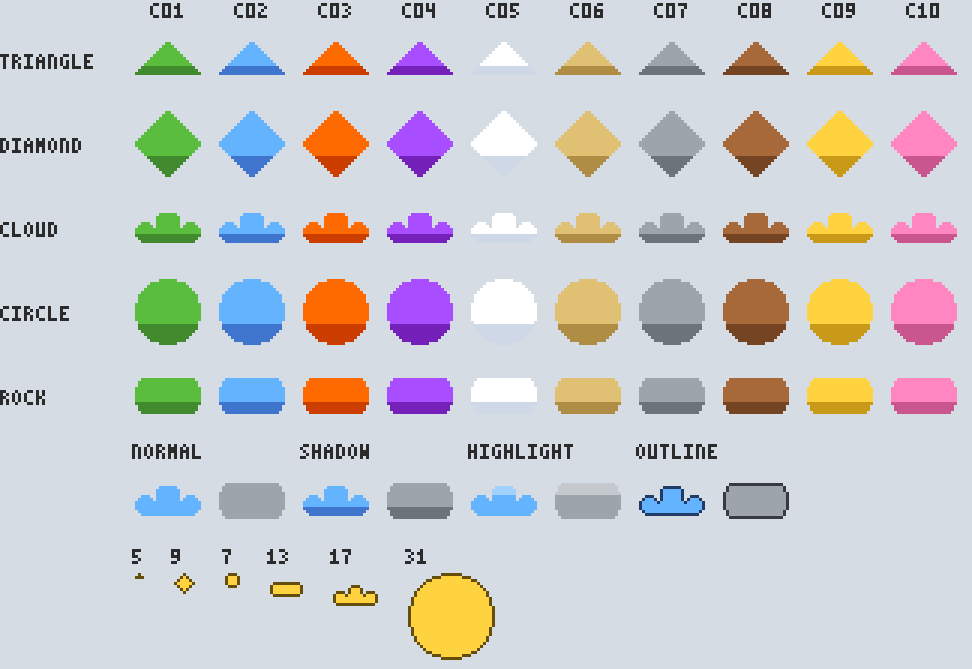

# Ironmate

Pythonを中心に、文書・画像などの**内容や属性の変換・置換**を検証するプロジェクトです。
PPTXの文字・色・矢印属性の置換を今後の対象とし、画素／パレットに基づくドット表現を試作しています。
要件は [Issue #80](https://github.com/myon-bioinformatics/Ironmate/issues/80)、
ドット表現の試作は [PR #79](https://github.com/myon-bioinformatics/Ironmate/pull/79) で追跡します。
Markdown→PPTX変換と既存PPTXの属性編集CLIは試作実装済みです。写真変換は第1段階（Base64→色番号グリッド）のみ試作済みで、キャラクター部品合成は未実装です。実装済みのドット表現の範囲は次節を参照してください。

## PPTX変換・編集

MarkdownからPPTXを生成する入口は **`pptx_pipeline.py`** に統一しています。旧`marp_pptx.py`は削除済みで、互換CLIは提供しません。引数の構築には固定vendorの`vendor/cli_args.py`を使用します。

```sh
python pptx_pipeline.py slides.md -o slides.pptx
python pptx_pipeline.py --text '# タイトル' -o slides.pptx
printf '# タイトル\n' | python pptx_pipeline.py - -o slides.pptx
# MermaidのSVG事前変換を行う場合のみ追加:
python pptx_pipeline.py diagrams.md --mmdc node_modules/.bin/mmdc -o diagrams.pptx
```

Marp CLIは事前インストールが必要で、コマンドが勝手にNode/npmを導入することはありません。標準の変換はローカルファイル参照を許可せず、`--mmdc`を使う場合のみ、信頼できる入力を対象にローカル参照を有効化します。出力JSONには変換とPPTX検査の結果が入ります。

既存PPTXの文字・色・属性を変更する場合は、独立した`pptx_replace.py`を使用します。詳細は[試作契約・検証状況](docs/pptx-cli-prototype.md)を参照してください。

## ドット絵の試作候補

`pixel_grid.py`で、5種類の形（手続き生成）・10配色（色ID `C01`〜`C10`）・4加工を、
形ごとの範囲内の任意サイズ（奇数も可）で再現可能な色番号グリッドにします。
きれいに描けないサイズは生成せずエラーにします。

| 形 | 最小〜最大サイズ |
| --- | --- |
| triangle | 5〜256 |
| diamond | 9〜256 |
| cloud | 16〜256 |
| circle | 6〜256 |
| rock | 7〜256 |

```bash
python -S pixel_grid.py --mask cloud --palette C01 --effect shadow --size 23
python -S pixel_grid.py --mask circle --palette C02 --size 31 --format png --scale 8 > circle.png
```

[第1弾の契約・検証・今後の設計](docs/pixel-grid-prototype.md)。



生成例（上から5形×色ID `C01`〜`C10`、加工shadow／cloud・rockで4加工／奇数サイズ5・9・7・13・17・31）。
`python -S grid_preview.py -o docs/pixel-grid-preview.png --force`で再生成でき、
テスト（`tests/test_grid_preview.py`）がコミット済みのPNGとbyte一致することを確認するため、実装と画像がずれません。

`photo_grid.py`は、Base64（生の文字列または`data:image/...;base64,`）または画像ファイルを
読み、同じ`ironmate-pixel-grid/1`形式（固定RGBA＋色番号グリッド）にします。

判定は拡張子ではなく先頭bytes（magic bytes）で行います。ファイルはそのまま、Base64は生の文字列または
`data:<type>;base64,`で渡せます（data URIのtypeは省略か `image/png`・`image/jpeg`・`image/jpg`・`image/webp` のみ）。

| 入力 | 判定 | 必要な依存 | 理由・挙動 |
| --- | --- | --- | --- |
| `.png`（8bit gray / gray+alpha / RGB / RGBA、非interlace） | 対応 | なし（標準ライブラリ） | PNGの圧縮はzlib（deflate）なので、標準の`zlib`＋`struct`で展開・filter復元できる。gray・RGBの`tRNS`（透明色）はalpha 0に反映（RGB値は保持、Pillowと画素一致）。zlib streamは終端・checksumまで必須で、切断・後続データはエラー。APNGはエラーにせず既定画像（IDAT）だけを読む（既定画像がアニメーションに含まれない場合も同じ。Pillow経由も一致） |
| `.png`（palette・16bit・interlace） | 条件付き | Pillow | 標準decoderは対象外の形式として明示エラー。Pillowがあれば自動でPillowで読む（無ければ「unsupported PNG …」「interlaced PNG …」のエラー）。palette＋`tRNS`の透明度もPillowでRGBAに反映（期待値と画素一致をテスト） |
| Base64のPNG（生の文字列） | 対応 | なし | 標準の`base64`で元のbytesに戻してから上と同じ処理。標準アルファベット＋`=`padding必須（URL-safe・padding省略はエラー）。空白・改行（CRLF）・BOMは無視 |
| data URI（`data:image/png;base64,`） | 対応 | なし | 上と同じ。typeと中身が違う場合（例：`image/jpeg`なのにPNG）や、上記以外のtype（gif・svg+xml等）は「unsupported data URI type」等のエラー |
| `.jpg` / `.jpeg`（ファイル・Base64・`image/jpeg`） | 条件付き | Pillow | JPEGはDCT＋ハフマン符号の展開が必要で、標準ライブラリにdecoderがない。Pillowが無い場合は「needs the optional Pillow package」エラー。EXIFの向きは補正 |
| `.webp`（同上、`image/webp`） | 条件付き | Pillow | WebPはVP8/VP8Lの展開が必要で、標準ライブラリにdecoderがない。Pillowが無い場合は同じエラー。アニメーションは先頭フレームのみ |
| `.svg` | `photo_grid.py`では非対応／`grid_tools.py load`で条件付き | なし（numpyがあれば高速化） | 写真入力（`photo_grid.py`）は従来どおり「SVG input is not supported」。ドット絵の読み戻し（`grid_tools.py`、`svg_raster.py`）は安全な部分集合のみ描画：`rect`（塗りのみ・面積で正確）、`circle`/`ellipse`/`polygon`（4×4 supersampling）、`g`（translateのみ）、`#rgb`/`#rrggbb`、`fill-opacity`/`opacity`。DOCTYPE・ENTITY、`path`・`line`・グラデーション・`style`/`class`・`script`・`image`・`text`・回転等の変形は理由付き`SvgError`。SVG経由の可逆性は保証しない（透明セルの色は`#00000000`になる） |
| `.gif` | 非対応 | — | LZW展開は自作が必要で、アニメーションのフレーム選択も未定義。Pillowは読めるが対象外として拒否（「GIF input is not supported」） |
| `.bmp` | 非対応 | — | 未採用（需要が出たら検討）。Pillowの有無に関係なく「BMP input is not supported」 |
| `.tif` / `.tiff` | 非対応 | — | 圧縮方式・複数ページ・色空間が多様で未採用。「TIFF input is not supported」 |
| `.ico` | 非対応 | — | 複数サイズの画像を含むため選択規則が未定義。「ICO input is not supported」 |
| `.heic` / `.avif` | 非対応 | — | HEVC/AV1の展開が必要。Pillowのビルドによっては読めるが対象外として拒否（「HEIC/HEIF/AVIF input is not supported」） |
| 判別できないbytes | 非対応 | — | 「unrecognized image format」エラー |

| 出力（`--format`） | 判定 | 必要な依存 | 理由・挙動 |
| --- | --- | --- | --- |
| JSON（既定） | 対応 | なし | `ironmate-pixel-grid/1`（固定RGBA＋色番号）。正規データ |
| SVG | 対応 | なし | 文字列として直接書ける（`grid_svg.py`、横方向の同色をまとめた`<rect>`） |
| PNG | 対応 | なし | `zlib`＋`struct`で8bit RGBAを書く（`grid_png.py`、整数倍の最近傍拡大、同じ入力は同じbytes） |
| Base64 | 対応 | なし | PNG出力と同じbytesを`base64`で文字列化。`--data-uri`で`data:image/png;base64,...`。photo_grid.pyの入力に戻せる |
| WebP出力 | 非対応 | — | VP8/VP8Lのencoderが標準ライブラリにない。要件外 |
| PPTXネイティブ図形 | 非対応 | — | ユーザー判断で対象外（画像出力のみ） |

エラーはいずれも`ValueError`（`ImageDecodeError`を含む）で、CLIは理由を表示してexit 2で終了します。
`-o`は既存ファイル・symlinkを上書きせずexit 2（「refusing to overwrite」）。置き換えるときは`--force`（一時ファイル＋`os.replace`で、symlinkの先ではなくsymlink自体を置き換える）。全CLI共通（`grid_output.py`）。
Pillowは必須依存ではありません。

```bash
base64 -w0 photo.png > photo.b64
python -S photo_grid.py photo.b64 --size 32 --colors 8
python photo_grid.py photo.b64 --size 16 --palette C01 --fit contain
python -S photo_grid.py photo.b64 --size 32 --format svg --scale 8 -o photo.svg
python -S pixel_grid.py --mask cloud --format svg > cloud.svg
python -S grid_svg.py grid.json -o grid.svg   # 既存のgrid JSONからSVG
python -S photo_grid.py photo.png --size 32 --format png --scale 4 -o dots.png
python -S pixel_grid.py --mask cloud --format png --scale 8 > cloud.png
python -S grid_png.py grid.json --scale 8 -o grid.png
python -S pixel_grid.py --mask cloud --format base64 --data-uri -o cloud.b64
python -S photo_grid.py cloud.b64 --size 16 --palette C01   # 元のgridに戻る
```

[写真入力の契約と制限](docs/pixel-grid-prototype.md#写真入力の最初の到達点base64からドットグリッドへ)。

### 1行で往復する（`grid_tools.py`）

AIエージェントが小さなBase64画像を本文に埋め込む用途向けに、生成・読み戻し・拡大縮小・色ID置換を
1関数／1コマンドにまとめました。標準ライブラリのみで動き、Pillow・numpyは任意（あれば同じ結果をより速く出す）。

```bash
python -c "import grid_tools as g;print(g.encode(g.make('cloud','C01','shadow',16),data_uri=True))"
python -m grid_tools make circle --palette C02 --size 32 --scale 4 > c.b64          # Base64（既定）
python -m grid_tools load c.b64 --to json                                          # 128px→32セルに自動復元
python -m grid_tools load dots64.png --to json                                      # 64×64（32の2倍）→32×32
python -m grid_tools load c.b64 --resize 64 --recolor C05 --to png --scale 4 -o c.png
python -m grid_tools load c.png --to svg -o c.svg                                   # PPTX用SVG
python -m grid_tools photo photo.jpg --size 32 --colors 8 --to base64 --data-uri    # JPEG/WebPはPillow
```

`encode`はPNGに`ironmate`のtEXtチャンク（色表と寸法）を既定で入れ、`load`/`restore`はそれがあれば
元のJSONをそのまま返します（`--no-meta`で付けない。既定のPNG bytes自体は`grid_png.py`と同じ）。

| 経路 | 可逆か | 条件（テストで固定） |
| --- | --- | --- |
| grid → PNG/Base64（meta付き、任意の`--scale`）→ load | JSONまで完全一致 | 色表に同じRGBAが重複する場合のみ、最初の番号に寄る（セルのRGBAは一致） |
| grid → PNG/Base64（metaなし）→ load | セルのRGBAが完全一致 | 倍率は`--size`指定、または全ての同色連続長の最大公約数で自動判定。判定は「説明できる最大倍率」なので、2×2模様だけの絵は小さく復元される（`--size`で解決）。色表は正規順（透明＋RGBA昇順）になり、元の色表が正規順ならJSONも一致 |
| 半透明（alpha 1〜254）・色数（1〜300色を検証） | 完全一致 | PNGはRGBA 8bitなので劣化なし |
| 拡大（整数・非整数とも）→ 元サイズへ縮小 | 完全一致 | セル中心での最近傍。拡大で全セルが残る |
| 縮小 → 拡大 | 一般に不可逆 | 各ブロックが単色のときだけ一致 |
| 色ID置換 A→B→A | 完全一致 | 色番号は不変。番号が5役割（0〜4）を超えるgridはエラー |
| grid → SVG → load | 見えるセルのRGBAが一致 | alpha 0のセルは`#00000000`。SVG自体の可逆は要件外 |
| JPEG/WebP → grid | 不可逆（縮小・減色・alpha二値化） | grid以降（PNG/Base64/SVG）は上の表のとおり |
| PNGの破損・改ざん | エラー | CRC不一致、IEND後の余分なbytes、zlib後の余分なbytes、meta headerの寸法・色表の不整合はすべてエラー（Pillow経由はIEND後の余分を無視する） |
| 縮小や補間で崩れたPNG | エラー | 「block … is not one color」「does not divide」。推測で直さない |

標準ライブラリ実装を基準（oracle）とし、テストでPillow（PNG展開・NEAREST拡大）とnumpy（倍率判定・拡大縮小・SVG描画）
の結果がbyte単位で一致することを確認しています。512×512 PNG→128セル復元の目安：標準約250ms、Pillow約190ms、numpy約180ms（手元計測）。

#### 縮小率と出力サイズの見積もり（`estimate`）

Base64の文字数上限（例：エージェントのメッセージ上限）に収めるための縮小率を出します。

読み込めるBase64は復号後32 MiB（33,554,432 bytes）までです（`photo_grid.MAX_BYTES`。flutter_navigation_basic の `maxInputBytes` と同じ値・同じ判定）。
出力はgrid_toolsと同じ8bit RGBA PNG（filter 0、zlib 9）として見積もります。
対象は**既定のgrid_tools出力**です。つまり`ironmate`メタデータ（tEXt）付きで、`load INPUT --size W --resize w2 --to base64 [--data-uri]`が実際に出す長さを測ります。メタデータを付けない出力を測るときは`--no-meta`（Python では`meta=False`）を指定します。

```bash
python -m grid_tools estimate --width 1024 --height 768 --bytes 900000 --limit-chars 200000 --data-uri
python -m grid_tools estimate photo.jpg --limit-chars 100000 --data-uri --verify   # 実際に符号化して確認
python -c "import size_estimate as s;print(s.estimate(width=64,height=64,nbytes=3000,limit_chars=2000)['recommended'])"
```

| 項目 | 内容 |
| --- | --- |
| Base64文字数 | `4*ceil(bytes/3)`（`=`padding込み、`--data-uri`なら`data:image/png;base64,`の22文字を加算）。厳密 |
| 推奨 | `recommended`（2/3・1/2など簡単な分数）、`integer_option`（1/k）、`lossless_option`（最近傍で無劣化） |
| 無劣化の判定 | 同色連続長の最大公約数（cell scale）をkが割り切る1/kのみ無劣化 |
| メタデータ | 既定で`est_bytes`・`upper_bytes`・`actual_bytes`にtEXt分を含む。resizeはパレットを全部残すので、色数の多い写真はヘッダーだけで大きくなる（その場合は`--no-meta`を案内） |
| 上限 | `upper_bytes`は無圧縮deflateとメタデータ込みの厳密な上限。`typical_low_bytes`は目安 |
| 使った信号 | `signals_used`：PNGのIHDR・PLTE・tRNS・IDAT圧縮率・meta、JPEGのSOF・量子化表からの品質推定・subsampling・EXIF、WebPのVP8/VP8L/VP8X、色数・alpha・エントロピー・連続長・cell scale |
| 信頼度 | `confidence`：low（寸法とbytesのみ）／medium（画素を再符号化して測定）／verified（`--verify`で各候補を`grid_tools.encode`で実符号化。各候補に同じ出力を出す`command`を併記） |

測定（写真のJPEG/WebP/PNG、ドット絵）では見積もりは実測の0.75〜1.6倍に収まりました。PNGの圧縮率は内容で変わるため、上限に近いときは`--verify`を使ってください。

#### かんたんAPI（`ironmate_image`）

縮小率・メタデータの有無・形式判定を気にせず呼べる窓口です（標準モジュールのみ。JPEG/WebP入力はPillowがあれば可）。
入力はパス・PNG/JPEG/WebPのbytes・Base64・data URI・ironmate JSONのどれでも構いません。

```bash
# 上限2万文字のBase64に収める（無劣化の縮小率を優先、入らなければメタデータを外して再挑戦）
python -c "import ironmate_image as im;r=im.fit_to_limit('a.png',max_chars=20000,data_uri=True);print(r.ratio,r.chars,r.meta_used,r.warnings)"
python -m grid_tools fit a.png --limit-chars 20000 --data-uri -o a.b64    # 結果の要約はstderrにJSON
# 行ったり来たり
python -c "import ironmate_image as im;s=im.to_base64('a.png');print(im.from_base64(s)['width'])"
python -c "import ironmate_image as im,grid_tools as g;print(g.encode(im.resize('a.png',64)))"
```

| 関数 | 内容 |
| --- | --- |
| `fit_to_limit(src, max_bytes=None, max_chars=None, data_uri=False, prefer='lossless')` | 実際に符号化して上限内に収まった最大の結果（`FitResult`：`data`・`text`・`ratio`・`width`・`height`・`bytes`・`chars`・`meta_used`・`lossless`・`command`・`warnings`）。画素を優先し（無劣化→大きい比率）、同じ比率ならメタデータ付きを選ぶ。どうしても入らなければ`FitError` |
| `to_base64(src, data_uri=False, meta=True)` / `to_png(src)` | 既定のgrid_tools出力 |
| `from_base64(s)` / `load(src)` | グリッド（dict）へ。メタデータ付きなら完全に元通り |
| `resize(src, width, height=None)` | 最近傍で拡大縮小（高さは縦横比を維持） |

`FitResult.command`は同じバイト列を出すgrid_toolsのCLIです（テストで一致を確認）。

#### プライバシー（元画像のメタデータは必ず捨てる）

出力（PNG・Base64・data URI・SVG・JSON）には、元画像のEXIF（GPS位置情報・撮影日時・機種・作者を含む）、XMP、ICCプロファイル、PNGの`tEXt`/`zTXt`/`iTXt`（作者・コメント等）、`eXIf`、`tIME`などは**一切含まれません**。画素だけを読み、出力はゼロから書き直すためです。`ironmate_image`・`grid_tools`（`photo`/`load`/`fit`）・`photo_grid`のすべての経路で、元の文字列が出力に残らないことをテスト（`tests/test_privacy.py`）で確認しています。

PNG出力に入るのは`IHDR`・`IDAT`・`IEND`と、既定ではironmateの`tEXt`1つだけです。その中身は次の項目に限ります（`--no-meta`なら付きません）。

| 項目 | 内容 |
| --- | --- |
| `schema`・`width`・`height` | 形式名とグリッドの大きさ |
| `colors`・`palette` | パレット（`#RRGGBBAA`の並び）と色ID |
| `mask`・`effect`・`fit`・`quantize`・`resampling` | 生成・変換の設定 |
| `source`・`restored` | 元画像の幅・高さ・形式名・倍率（数値と短い識別子のみ） |

これ以外のキーや自由な文字列は、書き出すときも、ironmateヘッダー付きPNGを読み込むときも捨てます（他のツールが作ったヘッダーに個人情報が入っていても引き継ぎません）。

#### クリップボード／Base64入力の事例集

`tests/fixtures/base64_bridge_cases.json`に、Base64画像の貼り付けで起きやすい入力（data URIのtypeと中身の不一致、ラベルなしGIF、大文字の`DATA:`、BOM、`;charset=`等のparameter、76桁CRLF改行、URL-safe、`%3D`padding等）と期待結果をまとめています。Ironmateでの扱い：
`;key=value`形式のparameterは受け付けて無視、引用符付きの値や`;base64`なしはエラー、上限はbyte数が正（文字数は`4*ceil(bytes/3)`から導出、空白は数えない）。他の実装（Flutter等）のテストでも同じJSONを読めます。

## 責務

- 共通GitHub操作・vendor管理は [親リポジトリ](https://github.com/myon-bioinformatics/myon-bioinformatics) と [gh_identity](https://github.com/myon-bioinformatics/gh_identity) を参照します。
- 旧GitHubカタログ、MCPサーバー、repository metadata／diagnostics、成果物provenance生成の試作は廃止しました。すべての旧APIが移管先に互換実装されているという意味ではありません。
- source／niconico実装とテストの移管先は [mcp-toolcall-lab PR #108](https://github.com/myon-bioinformatics/mcp-toolcall-lab/pull/108) です。先に移管先をマージしてから、この削除をマージします。API／MCPの差分吸収の設計は同repo #107で扱います。
- `vendor/` と `vendor.lock.json` はconsumerの固定コピーです。共有ツール51ファイル（LICENSEを含む）を親の管理方式で登録し、固定ハッシュ検証を行います。`vendor.lock.json` が唯一のprovenanceです。

紹介・メタデータは [ポートフォリオ](https://myon-bioinformatics.github.io/#ironmate) に集約します。Ironmate専用のmetadata stub Pagesは廃止し、このrepoで公開する実動デモが必要になった時に再検討します。

詳しくは [整理とvendor調査](docs/cleanup-stage-two.md)、[vendor CI](docs/vendor-automation.md) を参照してください。

## ローカルテスト

```sh
python -m pip install -r tests/requirements.txt
git clone https://github.com/myon-bioinformatics/xprobe.git build/shared
git -C build/shared checkout 7e7015b2df69ad446b968f6fa49711b5b1dbdd3f
git clone https://github.com/myon-bioinformatics/myon-bioinformatics.git .vendor-sync-tools
git -C .vendor-sync-tools checkout b000e5967cb7596f6f9f20fe396a686fdc700c16
python -S .vendor-sync-tools/vendor_sync.py check --manifest vendor.lock.json
python -m pytest -q -m 'not heavy'
```

xprobeと親のvendorツールはテスト用の別checkoutです。実行時依存として自動取得しません。
PPTX機能の実行には `python-pptx` が必要です。Marp変換時のみ別途インストール済みのMarp CLIが必要です。
