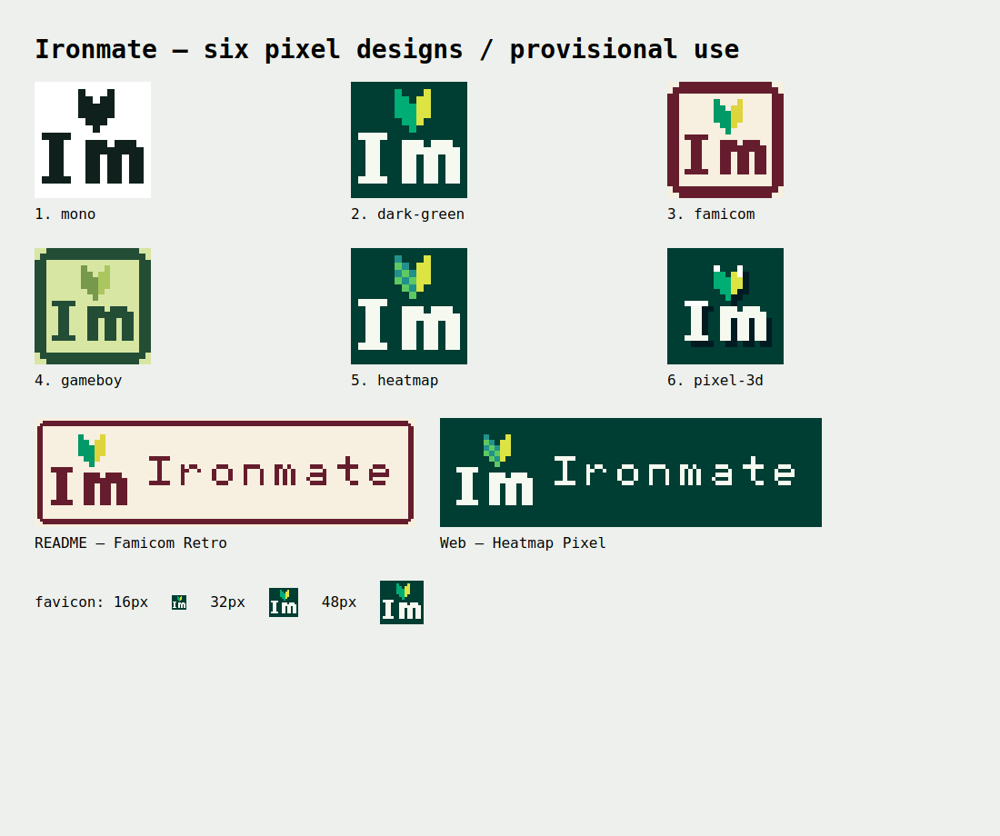

# Six Ironmate logo concepts

The shared core is **replacing the apostrophe in I’m with 🔰**. The favicon also keeps the I and m. **The official version is undecided.** The six concepts are used by purpose, and the assignments below are provisional.

| Concept | Assets | Intended use / current placement |
| --- | --- | --- |
| ① Pixel Mono | `studio/brand/mono.svg` | SVG logo, black-and-white material. Shown when printing the gallery |
| ② Dark Green | `studio/brand/dark-green.svg`, `icon-192.png` | Images for GitHub. Provisionally used as the favicon |
| ③ Famicom Retro | `studio/brand/famicom.svg`, `readme.svg` | Provisionally used at the top of the README |
| ④ GameBoy Style | `studio/brand/gameboy.svg` | Provisionally used in the six-concept gallery header |
| ⑤ Heatmap Pixel | `studio/brand/heatmap.svg`, `hero.svg` | Provisionally used in the three screens' headers and the browser tools' Hero |
| ⑥ Pixel 3D | `studio/brand/pixel-3d.svg` | Provisionally used for the add-to-home-screen icon and launcher |

The GitHub account's profile image is unchanged. Adding to a real device's home screen is up to the user; this change sets up the site's icon declarations and manifest.

## Common rules

A 16×16 integer grid is the shared glyph set, and letters are drawn with rectangles too. Nothing depends on fonts or emoji fonts. SVGs use `shape-rendering="crispEdges"`; PNGs use integer nearest-neighbor upscaling. The ICO holds 16, 32 and 48 px PNGs.

The heatmap inside 🔰 uses discrete cells, with no gradients. Famicom/GameBoy frames and 3D shadows are also drawn on integer coordinates, with no curves or blur.

## Replacing and regenerating

- Favicon: `rel="icon"` in `studio/index.html` and `studio/tools/index.html`. `icon.svg` is currently a compatibility name for Dark Green.
- Header: `.brand img` in the same HTML. Slide Studio is generated from Image Studio, so it updates at the same time.
- Hero: `.brand-hero` in `studio/tools/index.html`.
- README: the image link at the top.
- Home screen: `manifest.webmanifest` and `apple-touch-icon.png` (180 px). Provides 192 px and 512 px for Android, plus an opaque 512 px PNG for masking.
- Gallery: `/brand/`. Browse and save all six concepts; the mono version is shown when printing.

Run `python -S scripts/build_brand.py` at the repository root. It uses only the Python standard library and the existing `grid_png.py`.

Public files are specified by an explicit allowlist in `image_studio.py`, and the six SVGs are distributed for the gallery. The README-only SVG and the generator script are not distributed.

## Verification

- Related Python tests: 29 passed, 1 skipped (the existing slide shell regeneration, since `npm ci` was not run).
- Chromium: checked `/Ironmate/`, `/Ironmate/tools/`, `/Ironmate/slides/` and `/Ironmate/brand/` of the static build at 1440 px and 390 px widths. Across 8 cases, confirmed logo display, favicon 200 and that the brand frame fits. Browser manifest parsing and fetching home-screen icons also succeeded. No console errors.
- Local Python server: Content-Type and served bytes of SVG, PNG and ICO checked by existing tests.
- Visually checked actual-size display at 16, 32 and 48 px and integer upscaling.

[Browser check results](evidence/brand/browser-results.json) / [390 px screen](evidence/brand/mobile.png)

## Adding to the home screen

Use the browser's "Add to Home Screen". The Android manifest specifies the app name, icons, start URL, scope and shortcuts to the three tools. For iPhone, `apple-touch-icon` is specified for full screen. The favicon is ②; the home-screen icon is ⑥.

Tests verify that all foreground pixels of the maskable icon fit within the central 80% circle and that it has no transparent pixels. Adding on a real device is unverified, and the manifest declaration does not provide offline operation.

References: [Web App Manifest icons](https://developer.mozilla.org/en-US/docs/Web/Progressive_web_apps/Manifest/Reference/icons), [Apple Web Clip icons](https://developer.apple.com/library/archive/documentation/AppleApplications/Reference/SafariWebContent/ConfiguringWebApplications/ConfiguringWebApplications.html).

[Six-concept gallery on a phone](evidence/brand/gallery-mobile.png)
