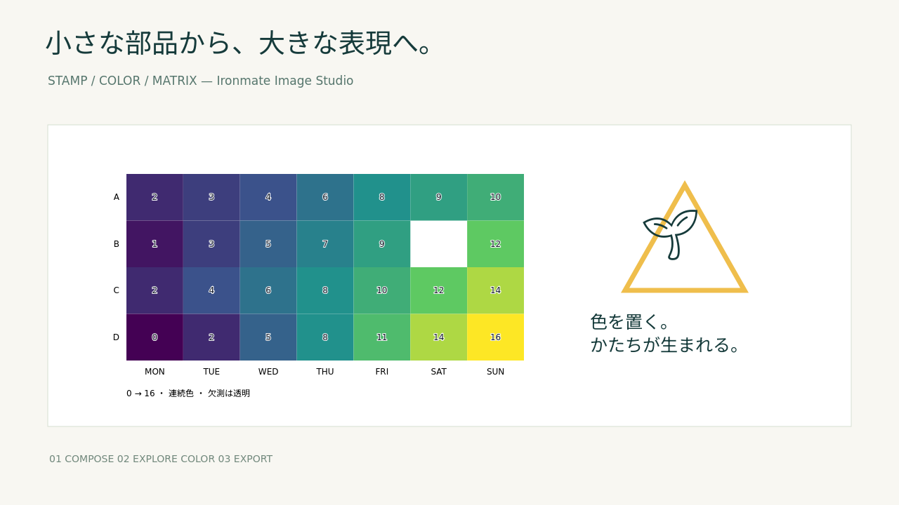

# Image Studio verification record

Recorded: 2026-10-17

An additional prototype on Ironmate main `680b35f6daeee52dff1ccf5998e313203ac7f210`.
It composites shapes, text, emoji and local images, and explores heatmap color steps and mosaic granularity.
The existing 3-Way Survey results, thresholds and raw data are unchanged.

## Actual output

- [Desktop screen](desktop.png) / [390 px-wide screen](mobile.png)
- [Generated PNG](demo.png) / [SVG](demo.svg) / [Re-editable JSON](demo-scene.json)
- [Real-browser verification results](browser-result.json) / [SHA-256 of target sources](source-sha256.json)

This is a synthetic example with made-up numbers, not Aoi's baseball analysis results.
No user-provided images are reproduced in the repository.

## Prior implementations referenced

| Target | Checked SHA | Referenced code |
|---|---|---|
| Flutter Navigation Basic | `13905a4d90f97daa73069d6fbff43acd6a65a760` | `lib/features/photo_studio/domain/studio_document.dart`, `photo_studio_state.dart`, `studio_geometry.dart`, `emoji_stamp.dart` |
| Aoi / DRAgoWing | `62ad1e49154121cf237d52de352404c4400e6a55` | `dragowing/figures.py::heatmap_figure`, rendering and export path |

Referenced: keeping state as layers, and separating display color from the original values.
No Dart code or Plotly itself was pulled in; Python and JS are independent implementations.
It does not reproduce Plotly chart rendering; it imports a single heatmap trace's values for compositing.
The first row is drawn at the top, so vertical order may differ if the Plotly axis settings differ.

## Numeric and image regression checks

`python -m pytest -q tests/test_image_studio.py`: **16 passed**.

- Python/JS color conversion: match across 37 conditions covering negatives, out-of-range, constant matrices, missing values and continuous/quantized.
- Original floats, nulls, axis labels and source are saved; changing color steps does not change values.
- Rejects non-rectangular input, bools, non-finite values, out-of-safe-integer values and extremely large integers.
- All pixels match between Python and JS for a 7×5 RGBA image under 4 conditions of cell width 1/3/128 and color steps 256/4/2.
- Block averaging accounts for alpha. The average of transparent blue and opaque red is semi-transparent red, not purple.
- Leftover edge cells are kept, and RGBA also matches after PNG encode/decode.
- Strings in SVG are escaped; external URL images, invalid sizes/angles and duplicate IDs are rejected.
- Confirmed a new edit after Undo drops the Redo branch, and state is not corrupted through shared references.
- Local HTTP serves only 4 fixed files and accepts neither other project files nor POST.
- The Python CLI does not overwrite existing output files without an explicit flag.

## Real-browser and PPTX verification

Python 3.12.14 / Node 24.19.0 / Chromium 133.0.6943.0 / Linux x86_64.
Browser automation uses test-only Playwright.
Noto fonts for Japanese and emoji were installed in the test environment for visual checks.
Emoji in this environment are monochrome; appearance varies with the device's emoji font.

`node tests/image_studio_browser.cjs`: passed.
The test starts its own Python server and stops it on exit. It connects to no CDN or external images.

| Check | Result |
|---|---|
| Placing shapes, moving from inside, scaling with the bottom-right handle | Passed |
| Turning the selected layer into a custom stamp, repeated placement | Passed |
| Placing emoji, layer count restored by Undo/Redo | Passed |
| Changing heatmap color steps | Original z values match exactly |
| Changing mosaic cell width, then back to 1 | Reuses the kept original image PNG |
| Processing 20 images beyond the cache limit | All images show processed pixels as configured |
| Save JSON → other edits → load | Scene matches exactly; PNG bytes match in the same environment |
| PNG export offline | Byte-identical to the online PNG |
| Selection handles | Not included in SVG/PNG |
| 390 px width | No horizontal page overflow |
| PNG → pinned PptxGenJS 4.0.1 → PPTX | PNG in media is byte-identical to the exported PNG |
| JavaScript exceptions, external HTTP requests | 0 |

A display test with images exceeding cache capacity led to a fix that passes the needed processed image to each render.
A regression test was added so an image evicted from the cache is never simply shown as the original.
This does not prove pixel smoothness, natural-image restoration accuracy or speed.
The PPTX check inserts images; stamps did not become native PPTX shapes.

## Existing features and CI

Studio paths were added to the existing Python/PPTX integration workflow.
Real-browser checks run in the latter half of the existing PPTX integration job, not placed where failing before existing tests
would skip PPTX checks. Browser evidence is also saved in the existing artifact.
Workflow permissions, distribution settings and the JUnit aggregation path are unchanged.

actionlint 1.7.7, Python compile, Node syntax check and git diff --check passed.
Parent tools and xprobe needed by the existing local suite were set up at the same pinned SHAs as the workflow.

`python -m pytest -q -m 'not heavy'`: **790 passed / 13 skipped / 7 deselected**.
The 13 skips are the existing optional Marp/Chromium lanes; no new Python/JS checks are skipped.
CI for real Marp/PPTX features and the new browser checks is also confirmed in the GitHub Actions integration job.
