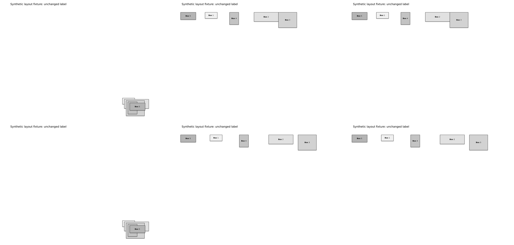
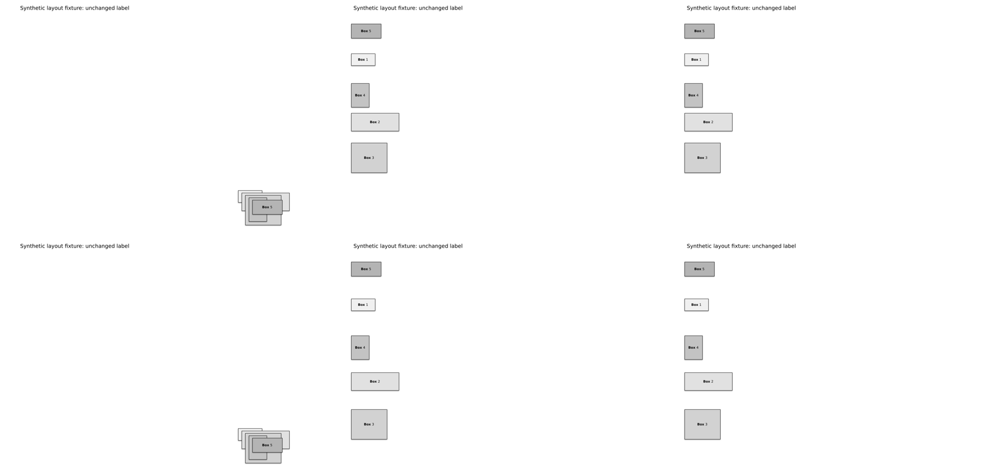
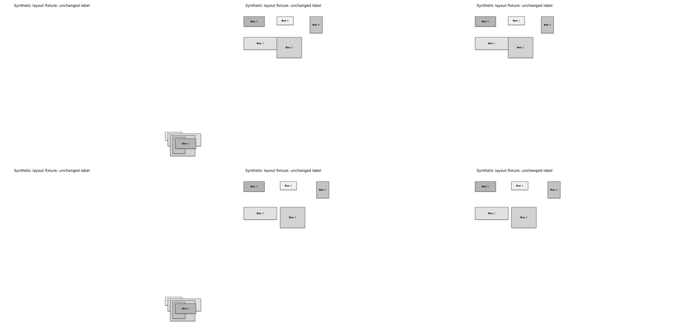

# PR #97 layout acceptance evidence

Synthetic fixture only. No photographed slide, reference-image content or user material is reproduced.

## Result and scope

On 2026-10-15 JST, all six cases matched literal expected coordinates and the independently positioned reference PPTX rendered with **0 changed pixels** at 1120 × 800. Contact sheets were inspected for location, spacing, overlap and labels. All five target labels and the unchanged heading were also extracted from each output PDF. No production layout discrepancy was found; the patch adds test coverage and evidence only.

The fixture has five rectangles with different widths **and** heights, a two-run label in each, and a nonselected heading. IDs are selected in order `[6, 2, 5, 3, 4]`, deliberately different from document order. The original targets overlap intentionally so the transformation is visible. Sizes are 1 × .5, 2 × .75, 1.5 × 1.25, .75 × 1 and 1.25 × .6 inches. The common cell is 2 × 1.25 inches. Positive-area overlap is absent in all outputs; zero-gap cells may touch.

All cases start at (.75, 1) inches. Grid has three columns and an incomplete final row. `row-zero` and `row-gap` set an irrelevant vertical gap of .9; column cases set an irrelevant horizontal gap of .9 to check that it does not affect layout.

| Case | gap_x, gap_y (inches) | Expected coordinates in selected ID order (inches) |
| --- | --- | --- |
| row-zero | 0, .9 | (.75,1), (2.75,1), (4.75,1), (6.75,1), (8.75,1) |
| row-gap | .4, .9 | (.75,1), (3.15,1), (5.55,1), (7.95,1), (10.35,1) |
| column-zero | .9, 0 | (.75,1), (.75,2.25), (.75,3.5), (.75,4.75), (.75,6) |
| column-gap | .9, .3 | (.75,1), (.75,2.55), (.75,4.1), (.75,5.65), (.75,7.2) |
| grid-zero | 0, 0 | (.75,1), (2.75,1), (4.75,1), (.75,2.25), (2.75,2.25) |
| grid-gap | .2, .3 | (.75,1), (2.95,1), (5.15,1), (.75,2.55), (2.95,2.55) |

Regression tests apply actual TOML through the CLI and compare against these literal coordinates, not against dry-run-derived expectations. They independently check size/text/name/ID preservation, full slide XML equality after normalizing only selected offsets, exact bytes of other package members, nonselected position, no positive-area overlap, unchanged source and idempotence.

## Visual comparison

Each image has three columns: **source / independent expected / actual**. Top row: zero gap. Bottom row: changed gap. The expected deck uses python-pptx setters with literal coordinates, without calling the layout implementation or reading its output. Full-resolution PNG differences were computed before making these smaller contact sheets.







The synthetic source PPTX, six actual outputs and their TOML rules are retained here for inspection in an actual PPTX viewer. `manifest.json` records the source/output/reference hashes and planned changes. `render-report.json` records renderer versions, image dimensions, differences and hashes of the full local rendering run; the intermediate PDFs, reference PPTX, PNGs and zero-difference images can be regenerated and are not all committed.

## Reproduction

From the repository root, with existing test dependencies:

```sh
python -m pytest -q tests/test_pptx_layout.py tests/test_pptx_xml_shapes.py tests/test_pptx_replace.py
python -m tests.fixture_pptx_layout build/layout-new
```

Optional local rendering, using already installed tools (no installation or download by the script):

```sh
python -m tests.fixture_pptx_layout build/layout-new-render --render
```

Use a new directory each time. Rendering requires soffice, pdfinfo, pdftoppm, pdftotext and Pillow. Missing tools, conversion errors, missing/extra PDF pages, dimension mismatch, missing labels or nonzero reference differences fail the check. The default test/CI lane does not install or require LibreOffice.

Observed environment: LibreOfficeDev 26.8.0.0.alpha0 (`2c87e51eeaa2b413ff4ae097b2705eea1995d8e5`), pdftoppm 26.05.0, pdftotext 24.02.0, DejaVu Sans. Renderer/font differences may change pixels in another environment. Recreated package/PDF hashes may differ due to timestamps and metadata.

**PowerPoint Web was not opened or verified.** Same-renderer reference equality is evidence for these synthetic layouts only. It does not establish PowerPoint Web rendering, cross-renderer/desktop equivalence, reference-photo fidelity, Japanese font substitution, text fitting, connector routing, or the whole of Issue #80. The optional local rendering requested for this acceptance check does not change the web-first product contract or add a renderer dependency to production or CI.
