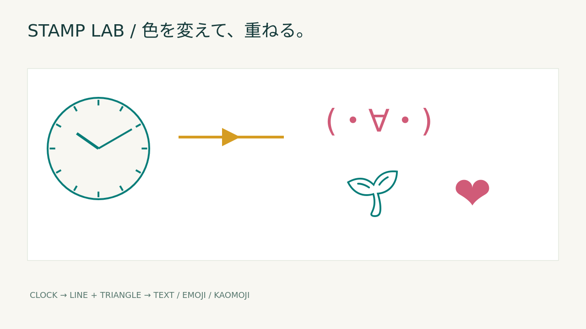
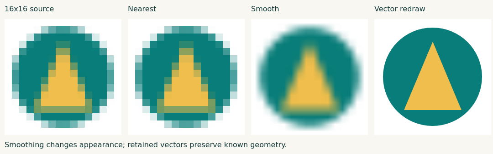

# Image Studio: Pages・Base64・CLIと拡大比較

2026-10-17。PR #110のImage Studioに対する追加検証。従来の
[初版の実験記録](../image-studio/report.md) と [Three-Way Survey](../three-way-survey/report.md)
は上書きしていない。本記録は合成スタンプと既知図形の描画・受け渡し検証であり、
構造検出IoUや自然画像の復元精度とは評価対象が異なる。

## 実装と受け渡し

- Pagesは相対パスのHTML/JS/CSS 4ファイルと空の`.nojekyll`だけを配信。
  `/Ironmate/`配下の静的HTTPサーバーで確認した。入力画像・scene・CLIプログラムは配信しない。
- PNGと同じバイト列を標準のpadding付きBase64／PNG data URIにして出力。
  実際のclipboard copy/readback、コピー拒否時の選択・手動コピーへの切替を実ブラウザで確認した。
- Flutter main `13905a4d90f97daa73069d6fbff43acd6a65a760` の
  `lib/shared/clipboard/base64_image_bridge.dart` と `photo_import_limits.dart` の入力契約を参照。
  decoded PNG 32MiB、標準Base64、MIMEと署名の一致を満たす。Flutter実機での貼付け実行は今回行っていない。
  Flutter側は最大40MPのデコードと4096pxへの縮小等を別途行うため、4倍PNGを貼っても
  Flutterのドキュメント寸法がそのまま維持されるとは限らない。
- 文字・顔文字・絵文字・PNGの単色化はalpha maskで指定色を塗る。
  赤青2領域の画像から、両領域が指定RGBA `[1,160,96,255]` になることを画素で確認。
  不透明な写真では画像全体が塗られる。被写体抽出ではない。
- 時計は保存した時刻の12目盛り＋2本の針。矢印は直線＋三角形で先端／中央配置を選択。
  既存PPTXの `arrow_geometry` と80ケース（seed `20261017`）で中心・方向の契約を比較。
- UIの2倍PNG、4倍SVG/PNG（5120×2880）、時計時刻／矢羽根位置の変更とundoを確認。
  同一viewBoxで文字・図形を再描画する。元画像は保持し、ラスター画像のみ補間方法を選択する。
- CLIはUIと同じ検証・SVGレンダラーをNode.jsで実行。PNG/Base64はNode.js 22以降の
  標準WebSocketとインストール済みChromeのCDPを使う。実行時npmパッケージや画像生成APIは不要。
  Chrome起動には `--disable-gpu` を指定。SVGにはChromeは不要。
  CLI PNGとBase64をデコードしたPNGはバイト一致。元sceneは変更しない。



[再編集用scene](stamps-scene.json) / [4倍SVG](stamps-4x.svg)

## 拡大の比較: 改善と悪化を両方記録

既知の円＋三角形を256×256で描いたPNGを基準とし、16×16へ縮小したPNGから256×256へ戻した。
RGBの全画素・全3チャンネル（白背景、0〜255、alpha除外）でMAEとRMSEを計算。
図形の元データを保持した再描画も同じ基準と比較する。学習や閾値調整は行っていない。

| 方法 | RGB MAE | RGB RMSE |
|---|---:|---:|
| 最近傍拡大 | 14.497629801432291 | 36.02362599237717 |
| なめらかな補間 | 16.515345255533855 | 30.6190683861587 |
| 保持した元図形の再描画 | 0 | 0 |

平滑化はRMSEを下げたが、MAEは悪化した。どちらか一方だけを採用して精度改善とは扱わない。
元図形の再描画が一致するのは座標・形・色が残っているためであり、16×16から未知の細部を推定した結果ではない。
自然画像、文字判読、顔の復元、超解像の性能は本試験から結論できない。
単一の合成例であり、手法間の一般的優劣を示すものではない。Three-WayのIoUとは直接比較しない。



[生の測定値](scale-results.json)、基準・最近傍・平滑補間のsceneも同ディレクトリに保持。

## 速度と失敗した試行

最初にChromeの `--screenshot` オプションだけでCLI出力する経路を試したが、
この実行環境では45秒のタイムアウトとなった。この失敗は成功扱いにしない。
採用したCDP経路の64×64単色PNGは、Python・Node・Chrome起動と終了を含む単発実測で
1381.553629msだった。速度比較用の反復ベンチマークではなく、数ミリ秒やGPU代替性能を示さない。
12MP写真は測定していない。フォントはOS依存で、日本語・絵文字の描画には適切なフォントが必要。

## 回帰確認

ローカル: Python 3.12.14 / Node 24.19.0 / Chromium 133.0.6943.0 / Playwright 1.58.2。
テストブラウザとCLIはGPUを無効化。rootの隔離実験環境でのみsandbox無効化環境変数を指定し、
製品CLIの既定ではChrome sandboxを無効にしない。

```sh
python -m pytest -q tests/test_image_studio.py tests/test_studio_delivery.py
IRONMATE_STUDIO_STATIC=1 IRONMATE_CHROME=/path/to/chrome node tests/image_studio_browser.cjs
```

- 対象Pythonテスト23件成功。default suite 797 passed / 13 skipped / 7 deselected。
- ブラウザ: 従来の配置・移動・拡縮・undo/redo・20画像キャッシュ・モバイル・offline・PPTX画像一致に加え、
  静的サブパス・Base64・clipboard・単色化・CLI・拡大を確認。page errorと外部リクエストはともに0。
  [実行結果](browser-result.json) に一覧を保存。
- actionlintとPython/Nodeの構文検査が成功。CIでは既存PPTX integrationで静的版を実行し、
  全ブラウザ出力をartifactへ保存する。Pages workflowはPRで配信物をbuildし、mainのみdeployする。
- [source-sha256.json](source-sha256.json) は本ローカル実験対象コードのSHA-256。
  フォントやChromeが違うCIとPNGのハッシュが一致することは要件にしていない。

ここでのコード確認とテストは実装者によるもので、独立した第三者の承認レビューとは区別する。

最終のUI確認で、旧sceneの`mono`省略時は元の描画どおり単色チェックをoffとする修正を追加。
旧scene選択時のチェック状態をブラウザで回帰確認し、全ブラウザ検証も再成功した。
そのコードは[regression-source-sha256.json](regression-source-sha256.json) に記録する。
上記の測定値・画像・最初のsource hashは変更せず保持した。
