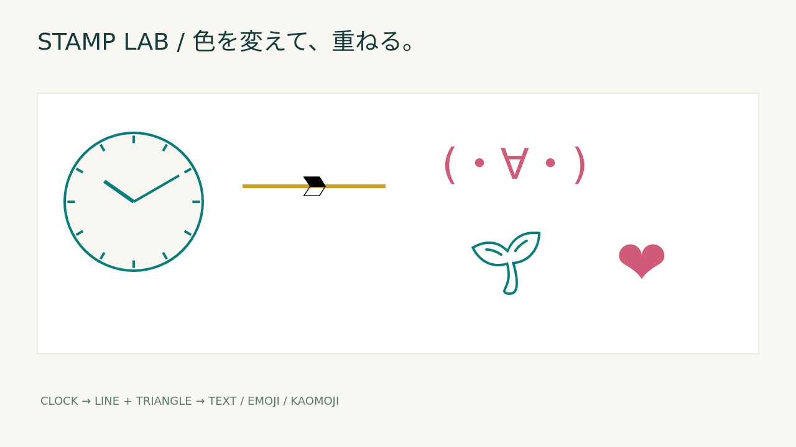

# Follow-up: a black 🔰 and multiple upscaling candidates

2026-10-17. Exploratory verification following the user's additional direction.
This record is added without deleting or changing the accuracy, speed or failures in the [first record](report.md).

## Making 🔰 a black arrowhead

The original 🔰 alpha is used to convert it to solid black, rotated -90 degrees and overlaid on a straight line.
It can be switched with the triangle and placed at the tip or center. Old scenes keep the triangle when the shape is omitted.
The same 🔰 button also works as a black text stamp. The browser verified that black pixels exist and zero yellow-green remains.
SVG and CLI use the same renderer. The shape depends on the OS emoji font; with the local monochrome font,
one side is filled and the other outlined. It is not treated as an exact match for a given device's color emoji.



[scene](beginner-scene.json) / [4x SVG](beginner-4x.svg)

## Two metrics and an equal-weight auxiliary score

MAE, RMSE, the 50% midpoint and a balanced version with explicit weights are kept as separate files.
Candidates 0–10 are nearest-neighbor/smooth-interpolation mix ratios 0.0–1.0, mixed in premultiplied alpha, 8-bit sRGB.
Comparison is on RGB composited onto white. Exact-match pixel counts and alpha error of the original RGBA are kept separately.
This does not replace the existing exact-match/residual evaluation or Three-Way IoU.

The auxiliary score is `100*(1-(w*MAE+(1-w)*RMSE)/255)`, with w=0.5 here.
It is a ranking under an explicit policy, not perceptual quality or a universal right answer.
Beyond a single ranking, all candidates, the Pareto set and input SHA-256 are saved.
The reusable contract is documented in [CLI and definitions](../../image-comparison.md).

### Results on the first 256×256 synthetic example (oracle selection after seeing this reference)

| Role | Smooth ratio | MAE | RMSE | Auxiliary score |
|---|---:|---:|---:|---:|
| MAE priority | 0.0 | 14.497630 | 36.023626 | 90.093871 |
| RMSE priority | 0.9 | 16.307892 | 30.612404 | 90.799942 |
| Midpoint | 0.5 | 15.440592 | 31.883027 | 90.720859 |
| Balanced | 0.8 | 16.094147 | 30.737891 | 90.817247 |

The balanced version has worse MAE than nearest-neighbor and worse RMSE than RMSE priority.
This disadvantage is kept too. Redrawing the original shapes is not entered as a competitor to take a trivial score of 100.
The [raw results](tradeoff-original/report.json), the 3 input PNGs and the 4 selected PNGs are saved in that directory.
PNGs for all 11 candidates are also saved as a CI artifact.

```sh
python -S image_compare.py --reference docs/evidence/studio-delivery/tradeoff-original/reference.png --nearest docs/evidence/studio-delivery/tradeoff-original/nearest.png --smooth docs/evidence/studio-delivery/tradeoff-original/smooth.png --out build/reproduce-tradeoff
```

## Exploration and follow-up with separate seeds and conditions

A known 128×128 reference is downscaled to 16×16 and back to 128×128.
Three conditions: shapes, pixel art aligned to the grid, and gradients. Each seed uses the same 11 candidate steps and the same weights.
Mix ratios for each role were selected on seed `20261017` alone, then applied fixed to `20261018` / `20261019`.
The first policy, pooling all kinds with equal weight, selected ratio 0 for MAE priority, RMSE priority and balanced alike.
The exact nearest-neighbor match on pixel art dominated, and no uniform improvement from smoothing was found. This result is kept.

Per-kind policies were also explored. Kinds are labels given to the fixtures, not automatic classification of unknown images.
Selected ratios came from each kind on seed17 only, but seed18/19 results had already been seen when this policy was added.
So seed18/19 for the per-kind policy are not counted as unseen independent confirmation.
Additional unused seeds `20261020` / `20261021` were generated and tested with ratios and weights unchanged.
Overall this is exploration on synthetic conditions and does not show generalization to natural images.

| Kind | MAE priority | RMSE priority | Midpoint | Balanced |
|---|---:|---:|---:|---:|
| Shapes | 0.0 | 0.7 | 0.5 | 0.6 |
| Pixel art | 0.0 | 0.0 | 0.5 | 0.0 |
| Gradient | 0.9 | 1.0 | 0.5 | 0.9 |

[Raw measurements for all 15 cases × 11 candidates](tradeoff-seeds.json) record the overall policy, per-kind policy and each case's oracle separately.
The per-kind policy is not guaranteed to match each case's oracle chosen after seeing the reference.

| seed | Kind | Fixed role | Mix ratio | MAE | RMSE | Auxiliary score |
|---|---|---|---:|---:|---:|---:|
| 20261020 | shapes | mae_priority | 0.0 | 6.370911 | 21.543645 | 94.526558 |
| 20261020 | shapes | rmse_priority | 0.7 | 7.029683 | 18.343335 | 95.024898 |
| 20261020 | shapes | midpoint | 0.5 | 6.775920 | 18.806648 | 94.983810 |
| 20261020 | shapes | balanced | 0.6 | 6.925130 | 18.526806 | 95.009424 |
| 20261020 | pixel-art | mae_priority | 0.0 | 0.000000 | 0.000000 | 100.000000 |
| 20261020 | pixel-art | rmse_priority | 0.0 | 0.000000 | 0.000000 | 100.000000 |
| 20261020 | pixel-art | midpoint | 0.5 | 12.307699 | 18.171395 | 94.023707 |
| 20261020 | pixel-art | balanced | 0.0 | 0.000000 | 0.000000 | 100.000000 |
| 20261020 | gradient | mae_priority | 0.9 | 0.338806 | 1.059422 | 99.725838 |
| 20261020 | gradient | rmse_priority | 1.0 | 0.333049 | 1.034500 | 99.731853 |
| 20261020 | gradient | midpoint | 0.5 | 0.536601 | 1.560487 | 99.588806 |
| 20261020 | gradient | balanced | 0.9 | 0.338806 | 1.059422 | 99.725838 |
| 20261021 | shapes | mae_priority | 0.0 | 5.731547 | 19.989512 | 94.956655 |
| 20261021 | shapes | rmse_priority | 0.7 | 6.092733 | 17.213413 | 95.430167 |
| 20261021 | shapes | midpoint | 0.5 | 5.951538 | 17.739647 | 95.354670 |
| 20261021 | shapes | balanced | 0.6 | 6.045471 | 17.449860 | 95.393072 |
| 20261021 | pixel-art | mae_priority | 0.0 | 0.000000 | 0.000000 | 100.000000 |
| 20261021 | pixel-art | rmse_priority | 0.0 | 0.000000 | 0.000000 | 100.000000 |
| 20261021 | pixel-art | midpoint | 0.5 | 11.954244 | 17.979732 | 94.130593 |
| 20261021 | pixel-art | balanced | 0.0 | 0.000000 | 0.000000 | 100.000000 |
| 20261021 | gradient | mae_priority | 0.9 | 0.962769 | 1.231685 | 99.569715 |
| 20261021 | gradient | rmse_priority | 1.0 | 0.962382 | 1.219326 | 99.572214 |
| 20261021 | gradient | midpoint | 0.5 | 1.121338 | 1.548952 | 99.476414 |
| 20261021 | gradient | balanced | 0.9 | 0.962769 | 1.231685 | 99.569715 |

## Implementation, verification and existing tools

The new CLI is a small module independent of the UI. It reuses Python's existing PNG decoder/encoder/output
and adds nothing to browser deliverables. web-ui's existing check is an exact PNG hash match, with a different purpose from this interpolation evaluation.
It draws on PythDRagoras's multiple axes, fixed selection conditions and separate-data confirmation, and SakAnalytics's sensitivity analysis,
without importing classification MCC etc. directly into pixel error. The checked SHAs and scope are stated in the CLI doc.

The 32 target Python tests and all browser tests, including static/offline/clipboard/CPU CLI/PPTX, passed locally.
Also checked: alpha-mask blackening and orientation, weights 0/1, rounding, hidden RGB, size mismatch, protecting existing files and the total candidate pixel cap.
Target code is recorded in [followup-source-sha256.json](followup-source-sha256.json).
No new Python/JS runtime packages, Flutter changes or vendor copies in other repos were added.
