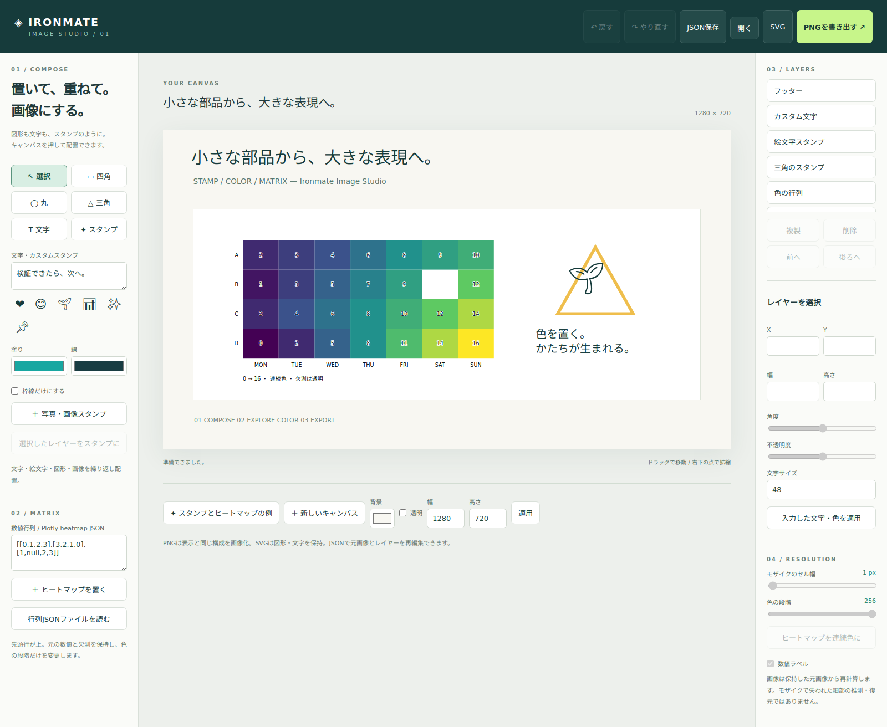

# Image Studio — スタンプを重ねて画像にする

```sh
python -S image_studio.py
```

表示された `http://127.0.0.1:8765` をブラウザで開く。Python標準ライブラリとブラウザだけで動く。
Dart・Flutter・Plotly・画像生成APIは不要。画像やシーンはブラウザ内で処理し、サーバーへ送信しない。
公開用の静的画面は https://myon-bioinformatics.github.io/Ironmate/ に配信する。
GitHub Pages上ではPythonなしで動く。公開対象は固定したHTML/JS/CSSだけで、作成した画像・シーンJSONは含めない。



## 操作

1. 「四角」「丸」「三角」「文字」を選び、キャンバスを押して配置する。写真なしでも使える。
2. 絵文字ボタンを選んで繰り返し押す。「文字・カスタムスタンプ」に任意の文字列も入力できる。
3. 「写真・画像スタンプ」でローカルのPNG/JPEG/WebPを置く。複数の画像を重ねられる。
4. レイヤーを選んで「選択したレイヤーをスタンプに」。図形・文字・画像・行列を複製して押せる。
5. 「選択」で内側をドラッグして移動、右下の青い点で拡縮。右の入力で位置・寸法・角度・不透明度を変更。
   文字のドラッグ拡縮はフォントサイズも変える。文字内容や色は「入力した文字・色を適用」で変更する。
6. 「前へ／後ろへ」で重ね順、「複製／削除」でレイヤーを編集。戻す／やり直すは最大40状態。
   JSONの読込や「新しいキャンバス」も履歴に残る。選択枠は書き出す画像には入らない。
7. PNG・SVGをダウンロード。再編集には「JSON保存」を使う。元画像・数値・レイヤーが入る。
   このJSONは元画像を含むので、共有すれば元画像も渡る。モザイク加工後の共有にはPNGを使う。

PNGは初期1280×720で、資料用の16:9画像として使える。背景は透明にもできる。
幅・高さを変更して任意の比率で作成できる（最大4MP、各辺64〜4096）。
ブラウザのJSON再読込で配置と元画像を保持し、同一ブラウザ・フォントではPNGのバイト一致を検証している。
フォント・絵文字の見た目は端末依存であり、環境をまたぐ画素一致は保証しない。
SVGの文字・絵文字はフォントに依存するalphaマスクまたはtextで、アウトライン化しないため、見た目を固定して配布する場合はPNGを使う。

## Base64でFlutterへ渡す

「Base64 / 渡す」で出力PNGを標準Base64にする。PNG data URI／Base64のみを切り替え、
コピーまたはテキスト保存できる。コピーを拒否された場合は文字列を選択して手動コピーできる。
出力はPNGのバイト列と完全一致する。URL-safe化、padding除去、百分率エンコードはしない。

Flutter main `13905a4d90f97daa73069d6fbff43acd6a65a760` の
`lib/shared/clipboard/base64_image_bridge.dart` を参照して確認した。
同実装が受け取れるPNG data URI／標準Base64、32MiB以下の条件で出力する。
Flutterのコード・ビルド・CIを変更せず、既存のクリップボード欄へ貼り付けるための受け渡しである。
Flutter上の実操作を今回再実行したという意味ではない。既存Pythonの厳密なBase64 decoderとPNGバイト一致で検証した。

## 時計・矢印・顔文字と単色のスタンプ

「時計」は入力した時刻のスナップショットで、12目盛りと2本の針を図形として保存する。
「矢印」は直線＋独立した矢羽根で描く。矢羽根は「🔰を黒にする」／「三角形」を選び、先端／中央へ配置できる。
🔰はalpha maskで黒一色にし、右向きへ90度回して重ねる。絵文字の形は端末のフォントに依存する。
旧sceneで形の指定がない矢印は従来の三角形のまま。絵文字ボタンの🔰も黒色スタンプとして置ける。
中央配置は既存PPTXの `arrow_geometry` と同じ中心・方向の契約で比較する。
回転で任意の方向を向けられ、SVG markerやネイティブ矢印には置換しない。

文字・顔文字・絵文字・画像を「単色で描く」にすると、元のalphaをマスクとして指定色を塗る。
カラーフォントが色を内蔵する場合も、単にtextのfillを変えることに頼らない。
写真を単色化すると不透明な範囲全体が塗られる。輪郭抽出・被写体の切り抜き機能ではない。
顔文字は文字入力から任意に追加できる。ASCIIアートには「等幅」を選べる。
「時計・矢印・顔文字の例」でそのまま試せる。

## 出力倍率とCLI

画面上部の1×／2×／4×／8×は、同じviewBoxを保ってSVG・PNG・Base64を再描画する。
元のシーンサイズやレイヤー座標は変更しない。最大8192px／辺・合計16MP。
文字・図形は元データから描き直し、埋込画像は「ドットを保持」／「なめらかに補間」で拡大する。
補間が細部を取り戻すという意味ではない。

GUIで保存したJSONも、Pythonで用意したJSONも同じレンダラーでCLI出力できる。
SVGにはNode.js、PNG/Base64にはNode.js 22以降とインストール済みChrome/Chromiumが必要。
画像生成API、GPU、Playwright/Puppeteerの実行時依存は不要。フォントはホストOSのものを使う。

```sh
python -S image_studio.py --render scene.json --format svg --scale 4 -o poster.svg
python -S image_studio.py --render scene.json --format png --scale 2 -o poster.png
python -S image_studio.py --render scene.json --format base64 --data-uri -o image.base64.txt
# ChromeがPATHにない場合のみ --chrome /path/to/chrome を付ける
python -S image_studio.py --build-site build/studio-site
```

出力先の既存ファイルは拒否し、明示した `--force` の場合だけ置換する。
静的サイト用の出力先は新しいディレクトリまたは空ディレクトリを指定する。

[MAE優先・RMSE優先・中間・バランス版のCLI比較](image-comparison.md) は、UIと分離した任意の実験ツールとして利用できる。

[拡大比較と受け渡しの検証記録](evidence/studio-delivery/report.md) に、成功・誤差・処理時間を残す。

## 数値 → 色 → ヒートマップ

「数値行列」に `[[0,1,2],[3,null,4]]` のようなJSONを入力して配置する。
行列JSONファイル、またはPlotlyの単一heatmap traceを含む `{data:[...]}` も読み込める。
`z`・`x`・`y`・`zmin`・`zmax`を利用し、**先頭行を上**に配置する。
Plotlyの軸順序・レイアウト・注釈・colorscale・customdataの描画互換ではない。
DRAgoWingの研究結果は書き換えず、JSONのsourceに入力を保管する別の合成画像である。

「色の段階」を2〜256で変えると色だけが量子化される。連続色に戻すこともできる。
元のz値は変更しない。nullは欠測として透明にし、0とは区別する。
セルのtitleにラベルと元の数値を入れる。数値ラベルは狭いセルでは省略される。
表示色は5点の独自スケールで、色の見た目が元グラフと一致するとは主張しない。
最大4096セル。NaN・Infinity・bool・JavaScriptの安全整数範囲を超える整数は拒否する。
JSONの小数は通常のPython/JavaScript浮動小数であり、任意精度の十進数計算ではない。

Pythonから編集用JSONを用意することもできる。

```sh
python -S image_studio.py --heatmap matrix.json -o scene.json
```

出力ファイルがあればエラーにする。意図した置換には `--force` を付ける。
作成したscene.jsonを画面の「開く」で読めば文字やスタンプを足せる。

## 画像 → モザイク → 粒度と色数を探索

画像レイヤーを選び、「モザイクのセル幅」と「色の段階」を変更する。
各ブロックの元RGBA画素を平均し、端の余りセルも含める。
RGBはalphaで重み付けし、透明画素の隠れた色が不透明画素を汚さないようにする。
各段階で保持した**元画像から**計算するため、セル幅を1・色段階を256に戻せば元の表示に戻る。
モザイク済み画像しかない場合に、失われた細部を復元する機能ではない。

Python側にも同じ演算を用意し、独立したJS実装とのRGBA一致をテストする。

```python
import grid_tools
from image_studio import mosaic
art = grid_tools.restore('input.png')
result = mosaic(art, cell=8, levels=16)
with open('mosaic.png', 'wb') as out:
    out.write(grid_tools.encode(result, 'png'))
```

このPython例はgrid_toolsが扱うPNG/gridを対象にする。
ブラウザ入力ではPNG/JPEG/WebPをブラウザがデコードしてPNGに正規化する。
完全透明の隠れたRGB・EXIF等のメタデータ保存、アニメーション保持は保証しない。

## PPTXとの接続

出力PNGをPowerPointへ画像として挿入できる。
既存のMarp/Markdown経路ではPNGをBase64のdata URIにして `` として埋め込める。
既存の標準変換はローカルファイル参照を許可しないため、相対パスのPNGがそのまま読めるとは限らない。
ブラウザ検証では、既存の固定PptxGenJS 4.0.1を使って1スライドPPTXに出力PNGを挿入し、
ZIP内の `ppt/media/*.png` が元PNGとバイト単位で一致することを確認する。
PPTX上で個々のスタンプをネイティブ図形として編集できるという意味ではない。
画面の書出し対象はPNG・SVG・JSON・PNG Base64。PPTXのサンプル生成は検証スクリプトで行う。

## 先行実装から引き継いだ範囲

| 参照 | 取り入れた考え方 | Ironmate側の実装 |
|---|---|---|
| Flutter 写真館 `studio_document.dart` / `photo_studio_state.dart` | 画像の有無と独立した枠・スタンプ、編集状態と履歴の分離 | SVGのレイヤーscene、JSON履歴、PNG画像化。Dartコードの移植はしない |
| DRAgoWing `dragowing/figures.py::heatmap_figure` | 数値と表示色の分離、欠測・ラベルの保持 | 単一heatmap JSONの数値取り込みと独自の色段階調整。研究値・描画定義を置換しない |
| Ironmate `grid_tools.py` / `grid_png.py` | 固定RGBAとPNGの画素検証 | Pythonモザイクの入出力に再利用 |
| IronmateのPptxGenJS | 既存の固定依存を使うPPTX生成 | ブラウザ出力PNGを挿入してmedia一致を検証 |

参照時点: Flutter main `13905a4d` を含む写真館、Aoi mainのDRAgoWing。
正確な確認SHAは [検証記録](evidence/image-studio/report.md) に記載する。
ソースは参照したが、他リポジトリのコードや依存物を新たにvendorコピーしていない。

## 制限と検証

最大100レイヤー、埋め込みPNGは1枚12MB・合計20MB、1画像4MP、シーンJSON20MB。
ブラウザのメモリ消費に依存するため、12MP写真の対話編集や処理速度は検証対象外。
画面はメモリ上で編集し、JSON保存前の変更があればページ離脱時に確認を出す。
ブラウザを閉じても自動復旧する機能はない。
元画像を含むシーン全体を履歴に保持するため、画像が多いとメモリ消費が増える。

### 作業履歴の保存・復元と整理

「作業履歴を保存」は最大40状態と現在の位置を
`ironmate-studio-workspace/1` JSONに保存する。「作業履歴を開く」で、画像を含む過去の状態と
undo/redoの位置まで復元できる。単一シーンのJSON保存とは別のファイル形式である。
保存・読込は共通の `StudioCore.workspaceText` / `workspaceHistory` を使い、
32MiB以下のUTF-8実byte数、状態数、現在位置、各シーンを検査する。
保存は状態ごとに容量を数え、上限超過時はdownloadも保存成功表示も行わない。
読込は全状態の埋め込み画像をデコードできた後で編集状態を置き換える。
読めない画像や不正な履歴を開いた場合、現在のシーン・履歴を保持する。

履歴欄の「現在の状態だけ残す」は確認後に過去のundo/redo履歴を削除する。
現在の画像・文字・図形・レイヤー属性は変更しない。容量超過時には、必要な履歴を先に別保存したうえで
この操作を使い、現在のシーンから履歴を保存し直せる。
画像を履歴状態間で重複排除する形式への変更や、ブラウザを閉じた後の自動復旧は含まない。

```sh
python -m pytest -q tests/test_image_studio.py
python -m pytest -q tests/test_studio_workspace.py
# ブラウザとPPTXの証跡。test-only Playwrightと既存pptxgenjsが必要
IRONMATE_CHROME=/path/to/chrome node tests/image_studio_browser.cjs
```

ブラウザ検証は既存のPPTX integrationジョブで実行し、既存workflowのartifactに証跡を添付する。
Python/JSの色変換、alpha付きモザイク、端の余り、数値保持、SVGエスケープ、履歴分岐、
HTTPの限定公開、既存ファイルの上書き拒否を回帰テストする。
実ブラウザでは移動・拡縮・カスタムスタンプ・絵文字・undo/redo・PNG/JSON往復・オフライン・
390px幅の横はみ出し・PPTX挿入を検証する。

画素完全一致・RGBA残差が可逆性の主判定である。
3-Way Surveyは構造の補助評価として継続し、この画面の画像品質を保証する指標には変更しない。
