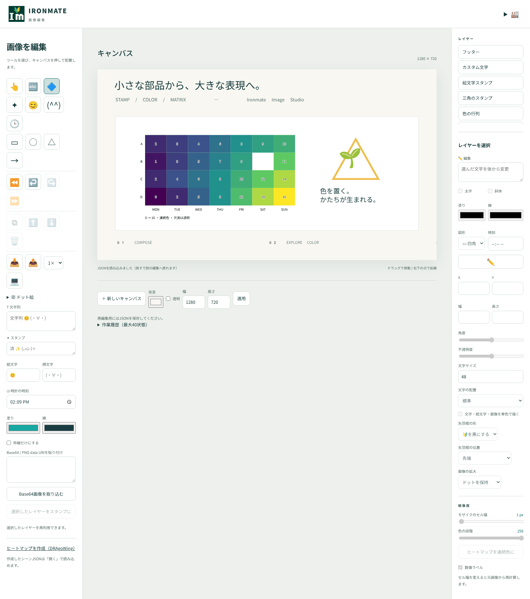

# Image Studio — layer stamps into an image

```sh
python -S image_studio.py
```

Open the shown `http://127.0.0.1:8765` in a browser. It runs with only the Python standard library and a browser.
No Dart, Flutter, Plotly or image-generation API is needed. Images and scenes are processed in the browser and not sent to the server.
A static public version is served at https://myon-bioinformatics.github.io/tools/#image-studio.
On GitHub Pages it runs without Python. Only fixed HTML/JS/CSS is published; images and scene JSON you create are not included.



## Usage

1. Choose `T 文字列` (text) or `図形(▭)` (shape; its candidates are `▭ ◯ △ →`) and click the canvas to place it. Works without photos.
2. Choose `絵文字` (emoji) or `顔文字` (kaomoji), pick a candidate and click repeatedly. Any string can be entered in `✦ スタンプ` (stamp). The four tools (text, stamp, emoji, kaomoji) each keep a field of their own; an empty one places its example. `◷ 時計` (clock) starts at the current time.
3. Place local PNG/JPEG/WebP files with `写真・画像スタンプ` (photo / image stamp). Multiple images can be layered.
4. Select a layer and use `選択したレイヤーをスタンプに` (make the selected layer a stamp) to duplicate and stamp shapes, text, images or matrices.
5. In `選択` (select) mode, drag the inside to move and the blue dot at the bottom right to scale. Change position, size, angle and opacity with the inputs on the right.
   Drag-scaling text also changes the font size. Change what is already placed with `✏️ 編集` (edit) on the right: the words, `太字` (bold), `斜体` (italic), fill and line colors, the shape, a clock's time.
6. Edit layers with `前へ／後ろへ` (forward / backward) for stacking order and `複製／削除` (duplicate / delete). Undo/redo keeps up to 40 states.
   Loading JSON and `新しいキャンバス` (new canvas) are also recorded in history. The selection frame is not included in exported images.
7. Download PNG or SVG from `📤` (どの形式に？ to which format?): it lists PNG, SVG, JSON, 作業履歴 (history) and Base64 in words, and a pick hides the list again; the `1×` beside it is the output scale. `📥` (どの形式から？ from which format?) lists 画像, カメラ, クリップボード (an image or image text), JSON, 作業履歴 and the clipboard shelf, the first three in the same order as the slide editor's. Use JSON for re-editing; it contains original images, values and layers. The tools are one toolbar on the left, the same PySaiyanWeBoo `toolbar` as the slide editor's, from one table (`studio_toolbar`: an act has one face and one word on both pages): rows of make (`👆 🔤 🔷 ✦ 😊 (^^) 🕒`), adjust (`⏪ ↩️ ↪️ ⏩`), change (`⧉ 🗑️ ⬆️ ⬇️`: copy, delete, one step forward / back) and file (`📥 📤`), with a dashed line between them; `🔷 😊 (^^)` open their candidates right under their row. The buttons show emoji by default; `💻` (at the end of the file row, as on the slide editor, or the `⋯` row) swaps them for short words on the same page, and `📱` swaps back; the choice is remembered. When the studio is shown inside a site with a shared header (the portfolio), the page carries no header of its own: it declares its rows as data (`image_studio.host_rows`: the shelf and `💻 To textual ⇄ 📱 To iconic` under `⋯`), a key from the header runs the same act as the toolbar, and the page's own top bar (the logo and `🏭`) and `💻` are hidden, so both studios are just their work under the one header.
   This JSON includes original images, so sharing it shares them too. Use PNG to share after applying a mosaic.

PNG defaults to 1280×720, usable as a 16:9 image for documents. The background can be transparent.
Width and height can be changed for any aspect ratio (max 4 MP, 64–4096 per side).
Reloading JSON in the browser keeps layout and original images, and PNG byte equality is verified in the same browser and fonts.
Font and emoji appearance depend on the device; pixel equality across environments is not guaranteed.
Text and emoji in SVG are font-dependent alpha masks or text, not outlined, so use PNG to distribute a fixed appearance.

## Passing to Flutter via Base64

`Base64 / 渡す` (Base64 / hand off) converts the output PNG to standard Base64. You can switch between PNG data URI and plain Base64,
and copy or save as text. If copying is refused, select the string and copy it manually.
The output matches the PNG bytes exactly. No URL-safe conversion, padding removal or percent encoding.

Checked against `lib/shared/clipboard/base64_image_bridge.dart` in
Flutter main `13905a4d90f97daa73069d6fbff43acd6a65a760`.
Output meets that implementation's accepted PNG data URI / standard Base64 at 32 MiB or less.
This is a hand-off for pasting into the existing clipboard field without changing Flutter code, builds or CI.
It does not mean the operation in Flutter was re-run this time. It was verified with the existing strict Python Base64 decoder and PNG byte equality.

## Image input and clipboard format selection

Drop one PNG, JPEG or WebP file on the Image Studio canvas, or use the file picker. Both paths and the camera file input use the same byte limit, MIME check and PNG normalization as clipboard images. A drop containing multiple files is rejected as a whole.

The Node entry runs the Python validator. Its regression test uses the same 19 Base64 cases as the archived Flutter project, including MIME mismatches, padding and data-URI parameters. The archived [Dart expectations](https://github.com/myon-bioinformatics/flutter_navigation_basic/blob/647fb74c36899e52906cce6db7fe0d1fbbb04bf2/test/fixtures/base64_bridge/flutter_expectations.json) can be compared offline. [Flutter #208](https://github.com/myon-bioinformatics/flutter_navigation_basic/pull/208) contains the published Ironmate → Flutter Web handoff test. Its PR-head Flutter workflow passed, and the separate Non-Dart E2E workflow reported a failure. These browser fixtures cover file delivery and decoded pixels. Camera hardware, OS dialogs and physical-device clipboard behavior require a separate device run.
Canceling file selection does not change the scene. `capture` is a hint to the OS/browser and does not guarantee the camera opens.

The clipboard's `画像を取り込む` (import image) chooses in this order.

1. If a valid image Base64/data URI can be read as text, it takes priority.
2. An explicit `data:image/...`, or raw Base64 starting with PNG/JPEG/WebP magic bytes, that is invalid is an error.
   It never silently imports a different older image. This includes MIME mismatch, decode failure and exceeding the size limit.
3. For unrelated ordinary text (including non-image Base64), an empty string or a failed text read,
   it looks for PNG/JPEG/WebP via `clipboard.read()`. Formats/items that cannot be read do not stop it from trying later images.
4. If nothing is obtained, it distinguishes permission denied, API unsupported, read failure, no image and invalid image.
   A permission denial on the text read alone does not abort. If both fail, priority is permission denied → invalid image → other read failures.

The error dialog's `data-code` is set to `clipboard-denied`, `clipboard-unsupported`,
`clipboard-read-failed`, `clipboard-no-image` or `clipboard-invalid-image`.
The Clipboard API needs a secure context (HTTPS/localhost), a user gesture or permission, and support depends on the OS/browser.
When unsupported or denied, the existing file selection and Base64 input remain available.

Spec differences, referencing [PhotoImportLimits](https://github.com/myon-bioinformatics/flutter_navigation_basic/blob/f8fe4e81d783258a4b8c730ea400acb7167372a2/lib/features/photo_studio/data/photo_import_limits.dart) and
[Base64ImageBridge](https://github.com/myon-bioinformatics/flutter_navigation_basic/blob/f8fe4e81d783258a4b8c730ea400acb7167372a2/lib/shared/clipboard/base64_image_bridge.dart)
in Flutter main `f8fe4e81d783258a4b8c730ea400acb7167372a2`:

| Item | Ironmate | Flutter Photo Studio |
| --- | --- | --- |
| Input byte limit | 32 MiB (after Base64 decoding; same for binary) | 32 MiB |
| Image pixel limit | 4,194,304 pixels (keeps the existing 4 MP limit) | 40,000,000 pixels |
| Downscaling on import | None. Over-limit input is explicitly rejected | Default 2/3, downscaled to a document long side of 4096 or less |
| Stored image | PNG-normalized after validation, import size kept | PNG-normalized and downscaled |

Ironmate's 4 MP is an intentional limit on existing mosaic processing and rendering load.
Reading 40 MP and downscaling it safely is not supported yet. Downscaling with Canvas after decoding does not reduce memory load during decoding,
and it affects the spec of keeping original images, so a change to automatic downscaling / 40 MP support will be verified separately.
Embedded PNGs in existing scenes are also limited to 12,000,000 characters per image and 20,000,000 in total, so a 32 MiB input is not necessarily storable.

Reproduction (test-only Playwright 1.58.2, no added runtime dependencies):

```sh
npm ci --ignore-scripts   # Playwright is a locked devDependency of the root package.json
npx playwright install --with-deps chromium firefox webkit
node tests/studio_clipboard.cjs
```

On the static build's `/Ironmate/` subpath, it checks the real-browser UI, PNG/JPEG/WebP decoding, RGBA, input byte/pixel boundaries and cancellation.
Coexisting formats, permission denial and lack of support are reproduced with test doubles at the Clipboard API boundary.
On Chromium it additionally writes ordinary text and a PNG together to a real `ClipboardItem` and reads them via the button.
Passing this test is not a claim about OS clipboard integration on Firefox/WebKit, real Android/iOS devices or real cameras.
CI runs the three engines independently and saves versions, checks and screenshots to `studio-clipboard-*` artifacts.
This reading logic stays in Ironmate and will not move to web-ui until real use in two or more places is confirmed.

## Clock, arrow, emoticon and monochrome stamps

`時計` (clock) is a snapshot of the entered time, saved as shapes: 12 ticks and 2 hands.
`矢印` (arrow) is drawn as a straight line plus a separate arrowhead. The arrowhead can be `🔰を黒にする` (make 🔰 black) or `三角形` (triangle), placed at the tip or center.
🔰 is made solid black through its alpha mask and rotated 90 degrees to point right. The emoji's shape depends on the device font.
Arrows in old scenes with no shape specified stay as the existing triangle. The 🔰 emoji button can also place a black stamp.
Center placement is compared against the same center/direction contract as the existing PPTX `arrow_geometry`.
Rotation can point it in any direction; it is not replaced with SVG markers or native arrows.

Setting text, emoticons, emoji or images to `単色で描く` (draw in one color) fills the chosen color using the original alpha as a mask.
Even when a color font has built-in colors, it does not rely on simply changing the text fill.
Making a photo monochrome fills its whole opaque area. It is not outline extraction or subject cutout.
Emoticons can be added freely through text input. `等幅` (monospace) can be chosen for ASCII art.
The canvas starts empty. Choose the text tool and click to place each text box. Select a text layer to edit it or move it one step forward or backward.
`⏪` / `⏩` in the toolbar go back / forward two states at once (`↩️` / `↪️` one).

## Output scale and CLI

1×/2×/4×/8× at the top of the screen redraw SVG, PNG and Base64 keeping the same viewBox.
The original scene size and layer coordinates are unchanged. Max 8192 px per side and 16 MP total.
Text and shapes are redrawn from source data; embedded images are upscaled with `ドットを保持` (keep pixels) or `なめらかに補間` (smooth interpolation).
Interpolation does not mean recovering detail.

JSON saved from the GUI and JSON prepared in Python can both be output from the CLI with the same renderer.
SVG needs Node.js; PNG/Base64 need Node.js 26+ and an installed Chrome/Chromium.
No image-generation API, GPU or Playwright/Puppeteer runtime dependency is needed. Fonts come from the host OS.

```sh
python -S image_studio.py --render scene.json --format svg --scale 4 -o poster.svg
python -S image_studio.py --render scene.json --format png --scale 2 -o poster.png
python -S image_studio.py --render scene.json --format base64 --data-uri -o image.base64.txt
# add --chrome /path/to/chrome only if Chrome is not on PATH
python -S image_studio.py --build-site build/studio-site
```

Existing output files are rejected and replaced only with an explicit `--force`.
For the static site, specify a new or empty output directory.

The [CLI comparison of MAE-priority, RMSE-priority, midpoint and balanced versions](image-comparison.md) is available as an optional experiment tool separate from the UI.

Successes, errors and processing times are kept in the [verification record for upscaling comparison and hand-off](evidence/studio-delivery/report.md).

## Numbers → color → heatmap

Open the [DRAgoWing heatmap editor](https://myon-bioinformatics.github.io/tools/#heatmap), paste a matrix or load a Plotly JSON file, then download scene.json and open it in Ironmate. The scene's heatmap `palette` is kept through editing, SVG and PNG export, and saving. Color conversion uses [PySaiyanWeBoo's shared heatmap code](https://github.com/myon-bioinformatics/PySaiyanWeBoo/pull/189).
It uses `z`, `x`, `y`, `zmin` and `zmax`, and places **the first row at the top**.
It is not rendering-compatible with Plotly's axis order, layout, annotations, colorscale or customdata.
DRAgoWing's research results are not rewritten; this is a separate composite image that stores the input in the JSON's source.

Changing `色の段階` (color steps) from 2 to 256 quantizes only the colors. It can be set back to continuous color.
The original z values are unchanged. null is treated as missing and drawn transparent, distinct from 0.
Each cell's title holds the label and original value. Value labels are omitted in narrow cells.
Scenes without a `palette` use the original five-stop Viridis-like scale.
Max 4096 cells. NaN, Infinity, bools and integers beyond JavaScript's safe integer range are rejected.
JSON decimals are ordinary Python/JavaScript floats, not arbitrary-precision decimal arithmetic.

Editable JSON can also be prepared from Python.

```sh
python -S image_studio.py --heatmap matrix.json -o scene.json
```

It errors if the output file exists. Add `--force` for an intended replacement.
Open the resulting scene.json with `開く` (open) on screen to add text and stamps.

## Image → mosaic → exploring granularity and color count

Select an image layer and change `モザイクのセル幅` (mosaic cell width) and `色の段階` (color steps).
Original RGBA pixels in each block are averaged, including leftover edge cells.
RGB is weighted by alpha so hidden colors of transparent pixels do not taint opaque ones.
Each step is computed **from the kept original image**, so setting cell width back to 1 and color steps to 256 restores the original display.
It does not restore lost detail when only a mosaicked image exists.

The same operation is also provided in Python, and RGBA equality with the independent JS implementation is tested.

```python
import grid_tools
from image_studio import mosaic
art = grid_tools.restore('input.png')
result = mosaic(art, cell=8, levels=16)
with open('mosaic.png', 'wb') as out:
    out.write(grid_tools.encode(result, 'png'))
```

This Python example targets PNG/grid handled by grid_tools.
For browser input, the browser decodes PNG/JPEG/WebP and normalizes to PNG.
Keeping hidden RGB of fully transparent pixels, metadata such as EXIF, or animation is not guaranteed.

## Connecting to PPTX

Output PNGs can be inserted into PowerPoint as images.
In the existing Marp/Markdown path, a PNG can be embedded as a Base64 data URI like ``.
The existing standard conversion does not allow local file references, so relative-path PNGs may not load as-is.
Browser verification inserts the output PNG into a one-slide PPTX with the existing pinned PptxGenJS 4.0.1
and checks that `ppt/media/*.png` in the ZIP matches the original PNG byte for byte.
It does not mean individual stamps are editable as native shapes in the PPTX.
On-screen export targets are PNG, SVG, JSON and PNG Base64. Sample PPTX generation is done by the verification script.

## What was carried over from prior implementations

| Reference | Idea adopted | Ironmate implementation |
|---|---|---|
| Flutter photo studio `studio_document.dart` / `photo_studio_state.dart` | Frames and stamps independent of whether there is an image; separating edit state from history | SVG layer scenes, JSON history, PNG rendering. Dart code is not ported |
| DRAgoWing `dragowing/figures.py::heatmap_figure` | Separating values from display colors; keeping missing values and labels | Importing values from a single heatmap JSON and custom color-step adjustment. Research values and rendering definitions are not replaced |
| Ironmate `grid_tools.py` / `ironlib/grid_output.py` | Pixel verification with fixed RGBA and PNG | Reused for Python mosaic input/output |
| Ironmate's PptxGenJS | PPTX generation using the existing pinned dependency | Inserts browser-output PNGs and verifies the media match |

Reference points: the photo studio including Flutter main `13905a4d`, and DRAgoWing on Aoi main.
Exact checked SHAs are in the [verification record](evidence/image-studio/report.md).
Sources were referenced, but no code or dependencies from other repositories were newly vendor-copied.

## Limits and verification

Max 100 layers; embedded PNGs up to 12 MB each and 20 MB total; 4 MP per image; scene JSON 20 MB.
It depends on browser memory use, so interactive editing and processing speed for 12 MP photos are out of scope.
Editing happens in memory, and leaving the page with changes not yet saved as JSON prompts for confirmation.
There is no automatic recovery after closing the browser.
History holds the whole scene including original images, so many images increase memory use.

### Saving, restoring and tidying work history

`作業履歴を保存` (save work history) saves up to 40 states and the current position to
`ironmate-studio-workspace/1` JSON. `作業履歴を開く` (open work history) restores past states with images,
including the undo/redo position. It is a different file format from single-scene JSON.
Save and load use the shared `StudioCore.workspaceText` / `workspaceHistory`,
checking real UTF-8 byte count of at most 32 MiB, number of states, current position and each scene.
Saving counts size per state; when over the limit, it neither downloads nor shows a success message.
Loading replaces the edit state only after every state's embedded images decode.
Opening unreadable images or invalid history keeps the current scene and history.

`現在の状態だけ残す` (keep only the current state) in the history panel deletes past undo/redo history after confirmation.
Current images, text, shapes and layer attributes are unchanged. When over the size limit, save the history you need separately first,
then use this to re-save history from the current scene.
It does not change the format to deduplicate images across history states, nor add automatic recovery after closing the browser.

```sh
uv run pytest -q tests/test_studio.py
uv run pytest -q tests/test_studio.py
# Browser and PPTX evidence. Needs test-only Playwright and the existing pptxgenjs
IRONMATE_CHROME=/path/to/chrome node tests/image_studio_browser.cjs
```

Browser verification runs in the existing PPTX integration job and attaches evidence to the existing workflow's artifact.
Regression tests cover Python/JS color conversion, mosaics with alpha, leftover edges, value preservation, SVG escaping, history branching,
restricted HTTP serving and refusing to overwrite existing files.
In a real browser it verifies moving, scaling, custom stamps, emoji, undo/redo, PNG/JSON round-trips, offline use,
horizontal overflow at 390 px width and PPTX insertion.

Exact pixel matches and RGBA residuals are the primary test of reversibility.
3-Way Survey continues as an auxiliary structural evaluation and is not turned into a metric guaranteeing this screen's image quality.

### Clipboard Shelf

The shelf keeps up to 20 items in page memory only, with no server upload or persistent storage.
The total of decoded image bytes and UTF-8 bytes of ordinary text is at most 32 MiB.
Base64 is checked for its exact size before decoding, and binary for `Blob.size` before `arrayBuffer()`.
Concurrent reads are reserved against the remaining capacity, and in-progress additions do not reappear after clearing.
Image copies become data URIs reusable in other pages and apps.
Preview Object URLs are released on deletion and on clearing all.

`studio_ingress.parse_shelf()` applies the same total size and 20-item limit (Python standard library only).
`data:` URIs, raw Base64 starting with a known image signature, and dicts specifying `type="image"` or `mime`
are validated as images; invalid formats, MIME mismatches and over-limit sizes are not demoted to text.
Strings with no image meaning are treated as ordinary text. Example image dict:
`{"type": "image", "mime": "image/png", "text": "data:image/png;base64,...", "label": "画像"}`.
Each returned item has `type`, `data`, `mime`, `text` and `label`.

Regression checks are `tests/test_studio.py` and `tests/studio_shelf_browser.cjs`.
The latter runs from the existing `tests/image_studio_browser.cjs` with static, Pages-equivalent serving.
Clipboard reads and permission errors are mocked, and validation, copy generation, URL release and image import are checked on real Chromium.
It does not directly operate OS-specific clipboard permission UI.
