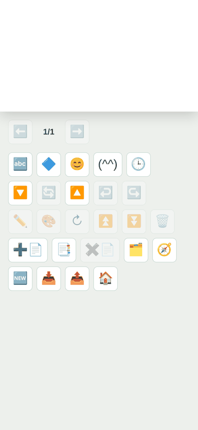

# Slide Studio: build multiple slides in the browser and save as PPTX

https://myon-bioinformatics.github.io/Ironmate/slides/

Image Studio's shape, text and image editing is reused per slide.
No installation, external CDN or server processing is needed. Input images and in-progress JSON are not sent anywhere.

## Usage

1. The first slide has a black title and body. Select a layer, paste into the text field on the left, and press `入力した文字・色を適用` (apply entered text and color). Adjust with the position, size and font size on the right.
2. Text boxes with content can be added from the title and body fields at the top. `文字の見本` (text samples) inserts Japanese, alphanumeric and English text into the body field. Titles are bold. You can also select a text layer and use `太字を切替` (toggle bold).
3. `編集できる矢印を追加` (add an editable arrow) places a straight line with a triangular arrowhead. Moving, scaling, rotating and recoloring work as in Image Studio. The centered arrowhead is also available.
4. Build a deck with `白紙` (blank), `スライド複製` (duplicate slide), slide selection, reordering and deletion. All slides use the same canvas size. Switching slides keeps the current layout and restarts the edit history.
5. `PPTXを書き出す` (export PPTX) saves all slides. Also using `全スライドJSON保存` (save all slides as JSON) lets you reload the editable data, images included, later. The regular `JSON保存` (save JSON) and `作業履歴を保存` (save work history) save only the current slide.

Unsaved changes are confirmed when leaving the page. There is no autosave or re-import of PPTX files.

## 📱 Phone slides

https://myon-bioinformatics.github.io/Ironmate/slides/phone/



A phone-first page for the same deck. The slide stays pinned at the top while you work, and every control is an emoji (its words are only in the tooltip / screen-reader label). Landscape puts the controls beside the slide.

| | |
| --- | --- |
| ⬜ | Starts blank (one 1280×720 slide) |
| 🔤 🟦 ⚪ 🔺 ➡️ 🖼️ | Add a text box (type right away), a rectangle, circle, triangle, arrow or picture (photos become PNG, at most 4 MP and 1920 px on the long side) |
| 👆 ↘ | Tap to select, drag to move, drag ↘ to resize. Tap a selected text box again (or ✏️) to edit it later; the editor sits under the slide at 16 px so phones do not zoom, and the slide updates as you type. A box left empty is removed |
| 🔽 🔄 🔼 | Every text box on every slide together: 0.5, 0.75, 1, 1.25, 1.5, 2, 2.5 × (titles keep their ratio to body text). New boxes start at 32 px × the current step |
| ▲ ◀ ▶ ▼ | The D-pad turns pages (▲ ◀ previous, ▶ ▼ next, like PowerPoint's arrow keys); the middle shows page / pages. Keyboard arrows do the same |
| ➕📄 📑 ✖️📄 🆕 | Add a blank page, duplicate, delete, start over |
| 🗑️ ↩️ ↪️ | Delete the selection, undo, redo (64 steps) |
| 💾 📂 📤 | All-slide JSON save / open (the same file Slide Studio opens, so arrows, images and fonts can be finished on a PC) and PPTX export |

The GIF is the frames `tests/slides_browser.cjs` saves (`build/pages-evidence/phone-*.png`, 390×844) at 1.4 s each.

The deck is also kept in the browser's local storage, so a reload or a killed tab comes back where it was. Nothing is sent anywhere. If the local storage is full (large pictures), the status shows ⚠️ 💾; save with 💾.

## What is editable in PowerPoint

| Target | Saved form in PPTX |
| --- | --- |
| Regular text | Native text box. Keeps line breaks, size, color, opacity, bold and rotation |
| Rectangles, circles, triangles | Native shapes |
| Arrows with triangular heads | A grouped straight line and triangular freeform. Keeps rotation and centering. Does not use the standard line-end arrow attribute |
| Images | PNG; the processed PNG when a mosaic is applied |
| Clocks, heatmaps, solid stamps, 🔰 arrows | Rendered to PNG per layer. That image's position, size and rotation remain editable in the PPTX |

The on-screen `タイトル` (title) and `本文` (body) are starter templates. They are exported as independent text boxes, not placeholders tied to a PowerPoint master.
Fonts are Meiryo normally and MS Gothic for monospace. Font files are not embedded. Missing fonts are substituted on the viewing side, so line-break positions, character widths and emoji display may not match.
Text wraps automatically at the box width. Japanese and English words are segmented, and long words or URLs wider than the box are split by grapheme. Splits never land inside combining characters or emoji. Explicit line breaks, blank lines and trailing line breaks are kept, and wrapping is recomputed when font size, bold, font or width change. Rotation is applied to the whole box after line splitting.
On-screen display and browser PPTX export use the same measured font metrics, line splitting and 1.3x line spacing. Explicit line breaks become PPTX paragraphs; automatic wraps become editable line breaks. Width-based wrapping on the PPTX side is also enabled. The exported line breaks remain, so widening the box in PowerPoint does not rejoin lines automatically. Narrowing it, font substitution or PowerPoint's typesetting may add extra wraps. Full Japanese line-breaking rules (kinsoku) are not applied.
There is no auto-shrink or automatic box-height change. Text taller than the box continues downward both on screen and in the PPTX, so adjust height, position or font size for long text. Automatic wrap positions are not written into the original text in the JSON. Half-width spaces and tabs at wrap points are trimmed at line ends, but the original text is kept in the JSON.
Old-format all-slide JSON, single-scene JSON and work history can also be loaded. Slide Studio's regular text wraps when `wrap` is omitted; with `wrap: false` only explicit line breaks apply. Image Studio's default when omitted is unchanged. Generating PPTX directly from Node uses a conservative character-width estimate instead of measured fonts, so line splitting may differ from browser output.
Even with multiple slides, a PPTX never converts a whole slide into a single image.

## Limits

Up to 20 slides; all-slide JSON and PPTX are each at most 32 MiB. Image Studio's limits, such as 100 layers and 4 MP per slide, also apply.
Layers converted to images are rendered at up to 4 MP. PNG compression efficiency and rendering fonts depend on the browser.
Edits involving images in the PPTX are kept in the re-editable JSON. Keeping photo EXIF, hidden RGB of fully transparent pixels or original image metadata in the PPTX is not guaranteed.
Reading arbitrary existing PPTX and reproducing themes, PDF rendering, animation, notes, and native tables/charts are out of scope for now.

## Implementation and regeneration

An empty PPTX skeleton is generated from PptxGenJS 4.0.1, pinned by the existing `npm ci`, and `pptxgen_render.mjs`. The generated XML is kept in the `<slide-shell>` region of `STUDIO_JS` inside `ironlib/studio_bundle.py` (the one browser script) with a fixed date for reproducibility. The browser loads no external libraries.

```sh
npm ci --ignore-scripts
python -S scripts/build_slide_shell.py
```

The Open XML writer in `STUDIO_JS` (`IronmateSlides` in `ironlib/studio_bundle.py`) assembles slide order, native text, shapes and image Open XML onto this skeleton and stores it in a standard ZIP with CRCs. Required parts and relationships are generated explicitly; no arbitrary XML, ZIP paths or external references are accepted from input JSON.
Only the generated XML, the one JS and CSS file, and the editor screen are added to `image_studio.py --build-site` and Docker's public allowlist. User output such as PPTX and images is not included in the public build.

## Verification

- Multi-slide decks generated on the Node side are checked with the existing PPTX inspection, XML parser, ZIP CRC verification and resolution of every Relationship.
- Checked string escaping, line breaks, color/size/bold, opacity, grouped arrows, and rejection of mismatched slide sizes and XML control characters.
- Confirmed the generated XML skeleton matches a regeneration from the existing pinned JS writer.
- In the browser, verified text editing, adding/duplicating/reordering/deleting slides, JSON save and reload, keeping current state on invalid input, and a two-slide PPTX with native text + arrows and a clock image.
- Verified long Japanese, English, URLs, combining characters and emoji; explicit line breaks, blank lines and trailing line breaks; and changes to width, font size, bold, monospace font and rotation. Each line shown in the browser was matched against the text, paragraphs and line breaks of the actually downloaded PPTX, and loading old JSON/work history and a 390 px width were also checked.
- Generated files were read with the test-only third-party library python-pptx and converted to PDF with LibreOffice for visual checks. Hands-on use in the Microsoft PowerPoint app has not been done.

```sh
uv run pytest -q tests/test_browser_slides.py tests/test_pages_tools.py tests/test_studio.py
node tests/slides_browser.cjs
```
